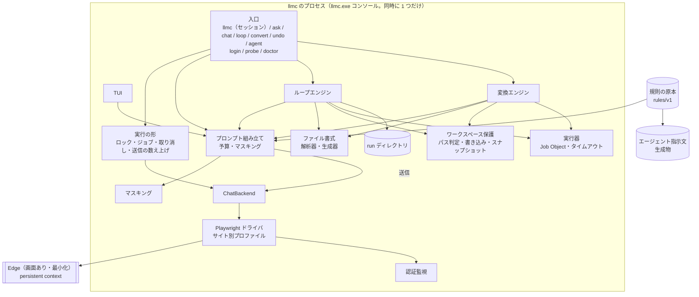
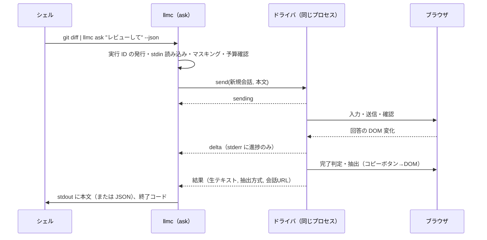
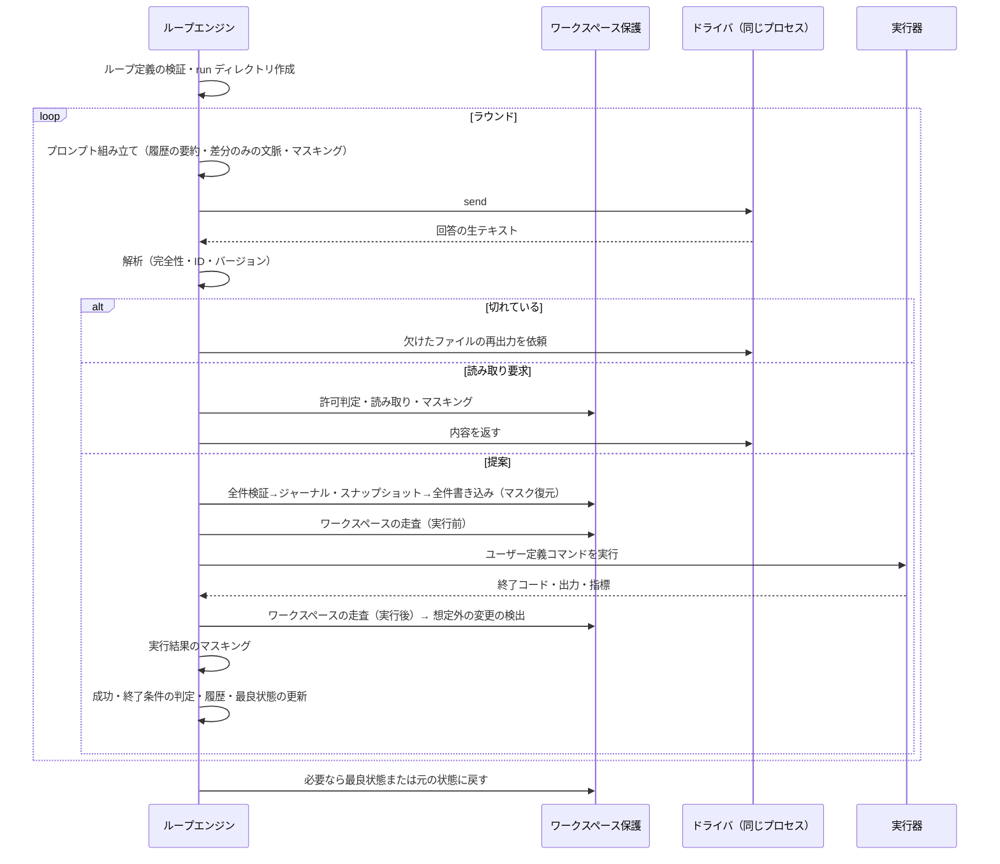

# アーキテクチャ

> **状態: 暫定版**。実物で確かめる仮説は plan.md 5.2 にまとめた。PoC の結果を受けて確定・修正する。

## 1. 方針

1. **v1 はデーモンを作らない。1 つのプロセスが、ブラウザも、ファイルの読み書き・実行・ループも持つ**（plan 前提 19、spec-runtime）。プロセス間通信・キュー・常駐の仕組みが要らない
2. **同時に動く llmc は 1 つだけ**。2 つ目は起動の直後に断る（`state\llmc.lock` のファイルのロック。ログオンのセッションによらず効く）。そのため、要求の順番待ちが要らない。起動の入口は `llmc` の 1 つで、引数なしで対話のセッション（ブラウザを開いたまま）、サブコマンドで単発（コマンドの間だけブラウザを開く）
3. **画面操作は `ChatBackend` インタフェースの裏に隠す**。Playwright による実装は、サイト別プロファイル（YAML）を読む汎用のドライバとする。Copilot 固有の差は Copilot 用プロファイルに閉じ込める
4. **書式の規則の原本は 1 つ**。プロンプト用の規則とエージェントの指示文は、そこから生成する
5. **llmc の状態は作業リポジトリの外に置く**。`%LOCALAPPDATA%\llmc\` に集め、権限を本人だけに絞る
6. **保護の境界を明示する**。llmc が守れるのは、llmc 自身が書き込むファイルまでである。ユーザー定義のコマンドで実行される AI のコードは、llmc の保護（許可リスト、変更禁止、スナップショット）の外で動く。この境界での対策（実行前後のワークスペースの走査、評価をワークスペースの外で行うことなど）は spec-security と spec-loop で定める

## 2. コンポーネント



| コンポーネント | 責務 | 主な仕様書 |
|---|---|---|
| CLI | 引数の解析、入出力の文字コード、終了コード、JSON 出力、実行 ID の発行 | spec-shell-integration |
| TUI | 画面表示、入力、スラッシュコマンド | spec-tui |
| プロンプト組み立て | タスク・文脈・履歴・規則を、入力欄の上限（予算）に収まるように組み立てる | spec-loop、spec-agent |
| マスキング | 送信前の置換（本文、文脈ファイル、添付用の一時ファイル、実行結果、読み取りの返答）と、書き込み時の復元（マスクを作ったファイルの中だけ） | spec-security |
| ファイル書式 | 回答の解析、文脈ファイルの埋め込み、エラーの分類と再依頼文の生成 | spec-file-protocol |
| ワークスペース保護 | パスの正規化と許可判定、文字コードと改行の保持、全件書き込みか全件取り消しか、ジャーナルとスナップショット、実行前後のワークスペースの走査 | spec-file-protocol、spec-loop、spec-security |
| ループエンジン | ラウンドの状態遷移、成功・終了条件、指標、履歴、最良状態 | spec-loop |
| 変換エンジン | UC5 の方式の選択、出力の検証、レシピ | spec-convert |
| 実行器 | ユーザー定義のコマンドの起動、タイムアウト、プロセスツリーの終了、出力の収集 | spec-loop、spec-security |
| 実行の形 | 1 つだけ動かす仕組み（ファイルのロック）、Ctrl+C での取り消し、ブラウザを開く・閉じる時期、Edge のプロセスの後始末（ジョブ）、送信回数の上限（NFR-14）の確認 | spec-runtime |
| ChatBackend | 共通インタフェース（会話・送信・ストリーム・抽出・添付・ダウンロード） | spec-browser-driver |
| Playwright ドライバ | サイト別プロファイルに従う画面操作 | spec-browser-driver |
| 人が送信する方式 | クリップボード経由で、利用者が貼り付け・送信・コピーをする `ChatBackend`（自動操作の送信が拒否される個人の Copilot 用） | spec-browser-driver 13 章 |
| 認証監視 | ログイン状態の判定、セッション切れの検知 | spec-auth |

## 3. プロセス構成

| プロセス | 起動方法 | 寿命 | 備考 |
|---|---|---|---|
| llmc | 利用者・スクリプト・タスクスケジューラ | 単発のコマンドはその 1 回分。対話のセッション（`llmc` を引数なしで）は閉じるまで | venv の console script `llmc.exe`。**同時に 1 つだけ**（`state\llmc.lock` を `LockFileEx` でロック。取れなければ `EXIT_BUSY`）。起動用のプログラムが 2 段ある（`llmc.exe` → venv の `python.exe` → 本当の Python）。本当の Python が起動の直後に自分用のジョブを作って入り、落ちたときに Edge も終わるようにする（spec-runtime 3 章）。タスクスケジューラでは「ログオンしているときのみ実行する」にする |
| ブラウザ（画面ありの Edge、最小化） | llmc が、送信が要るときにはじめて起動 | 単発のコマンドはその終わりまで。セッションでは閉じるまで | persistent context。プロファイルは `%LOCALAPPDATA%\llmc\profiles\<site>`。組織の PC ではヘッドレスがポリシーで禁止されている（回避しない）。人が送信する方式のサイトでは起動しない |
| ユーザー定義のコマンド | 実行器が起動 | タイムアウトまで | Job Object に入れ、終了時にプロセスツリーごと終了する |
| 手元変換のスクリプト（UC5 方式 C） | 実行器が起動 | タイムアウトまで | 確認または事前承認が必須 |

- `llmc login` は、ブラウザのウィンドウを元に戻してログインの画面を出す（spec-auth）。セッションの中では `/login`
- 人が送信する方式（spec-browser-driver 13 章）も、同じプロセスの中で動く
- 単発のコマンドは、毎回ブラウザの起動を待つ（PoC-8 の準備で、準備ができるまで 18.7 秒）。続けて使うときは対話のセッションを使う

## 4. プロセス間通信

v1 には無い（デーモンを作らないため）。対話のセッションを開いている間に、別のターミナルから `llmc` を実行すると断られる。セッションの中では、`/ask -i <ファイル>` と `/run <コマンド> -- <要求>`（コマンドの出力を入力にする）で、シェルのパイプの代わりにする（spec-runtime 2.2）。

v2 でデーモンを足す場合の案（名前付きパイプ、DACL、所有者の確認、認証キー、メッセージ、キュー）は spec-runtime 付録 A に残した。

- 進捗イベント: `sending` → `sent` → `first_token` → `delta`（複数回） → `completing` → `extracting` → 結果。名前と意味は spec-browser-driver 2.3 を正とする
- **会話は送信ごとに指定する**。ドライバが指定の会話（URL）へ移ってから送るので、セッションの中で対話とループを切り替えても会話が混ざらない

## 5. データフロー

### 5.1 単発の問い合わせ（UC2）



### 5.2 ループ（UC3）



## 6. ディレクトリ構成

### 6.1 ユーザーごとのデータ（`%LOCALAPPDATA%\llmc\`、本人だけに権限）

```
%LOCALAPPDATA%\llmc\
  config.yaml              利用者の設定（既定のサイト、エージェント、マスキングの共通規則など）
  sites\                   サイト別プロファイルの上書き（同梱の既定値に重ねる）
  profiles\<site>\         ブラウザのプロファイル（SSO の Cookie を含む）
  state\                   いま動いている llmc の表示用の記録、送信回数の記録、1 日の上限の記録（spec-runtime 7 章）
  journal\                 ループ以外の書き込みのジャーナルとスナップショット（llmc undo 用）
  agents\                  llmc agent build の既定の出力先
  logs\                    ログ（実行 ID ごと。本文は書かない）
  diag\                    画面の不具合の報告（スクリーンショット、DOM の断片）。既定で 7 日後に削除
  history\                 対話の履歴（UC1）
  runs\<プロジェクト>\<run-id>\   ループと変換の記録（既定の置き場所）
  recipes\                 利用者のレシピ
```

- ローミングプロファイルで同期されないよう、`%APPDATA%` ではなく `%LOCALAPPDATA%` を使う
- 作業リポジトリには、ユーザーが書いたループ定義やレシピ以外、llmc は何も置かない（`.git/info/exclude` への追記も不要）

### 6.2 llmc のリポジトリ（実装時の想定）

```
src/llmc/
  cli/  tui/  runtime/        runtime: 1 つだけ動かす仕組み、ブラウザの管理
  backend/            ChatBackend インタフェース
    playwright/       汎用ドライバ
    manual/           人が送信する方式（クリップボード）
    sites/            同梱のサイト別プロファイル（copilot-m365.yaml など）
  protocol/           ファイル書式の解析器・生成器
    rules/v1/         規則の原本
  workspace/          パス判定・書き込み・スナップショット
  loop/  convert/  exec/  security/
agents/<名前>/        生成したエージェントの指示文と構成（手作業で画面に反映）
docs/
tests/                モックページ、書式の境界値、文字コード
```

## 7. 拡張点

| 拡張点 | 方法 |
|---|---|
| 別のチャットサイト | サイト別プロファイルを追加。DOM の構造が大きく違う場合のみ、ドライバに「フック」（サイト専用の小さな関数）を追加する |
| API が使えるようになった場合 | `ChatBackend` の別実装を追加する |
| デーモン（v2 の候補） | 単発のコマンドの起動の待ちが問題になったら、ブラウザを常駐させるデーモンを足す（spec-runtime 付録 A）。`ChatBackend` の形は変わらない |
| OpenAI 互換のエンドポイント（スコープ外） | デーモン（v2）に HTTP の受け口を足す形になる |
| 新しい書式のバージョン | `protocol/rules/v2` と解析器を追加。回答のバージョン表記で解析器を選ぶ |

## 8. 主な設計判断

| 判断 | 採用 | 主な理由 | 退けた案 |
|---|---|---|---|
| プロセスの形 | 1 つのプロセス、同時に 1 つだけ（v1） | 利用者は本人だけで、1 つのターミナルから使う。プロセス間通信・キュー・常駐の仕組みが要らず、実装が小さい。対話のセッションでブラウザを開いたままにできる | ブラウザを常駐させるデーモンと軽いクライアント（単発のコマンドの待ちが無いが、作るものが多い。v2 の候補） |
| 状態の保存場所 | `%LOCALAPPDATA%\llmc` | 秘密情報を作業リポジトリに置かない（参考実装 #6・#11） | リポジトリ内の作業ディレクトリ |
| ロールバック | スナップショット（元のバイト列） | git の有無に依存せず、ユーザーの履歴を変えない（参考実装 #6・A9） | git のコミットと `reset --hard` |
| 同時実行 | 2 つ目の llmc を断る | 本人の 1 アカウントで並列にしても、レート制限に当たるだけで利点が少ない | 複数タブで並列、キューで順番待ち |
| 送信回数の計数 | ファイル（`state\sends.jsonl`） | 同時に動くのは 1 つなので、ロック無しで実行をまたいで数えられる | デーモンで数える |
| ブラウザの共有 | しない | リモートデバッグのポートで他のプロセスからつなぐ案は、同じ PC の他のユーザーからもログイン済みのブラウザを操作できてしまう。組織のポリシーで禁止されていることもある | `connect_over_cdp` |
