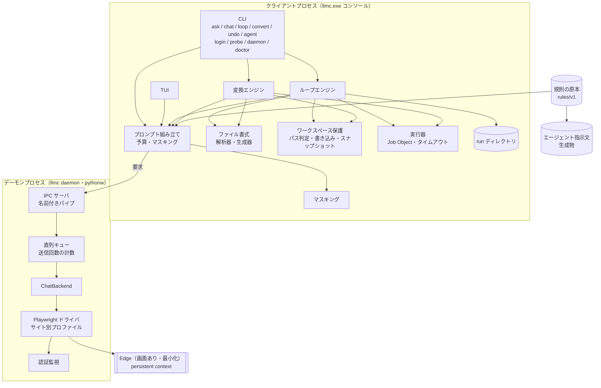
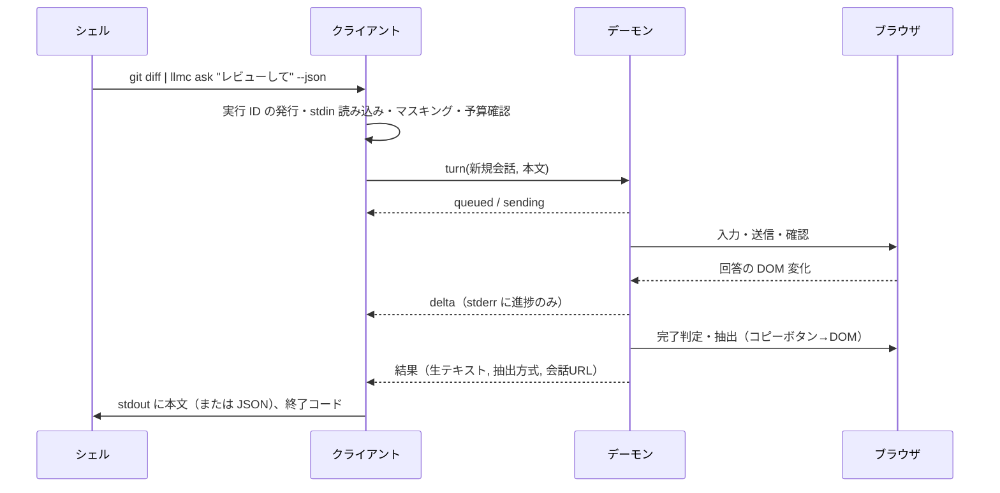
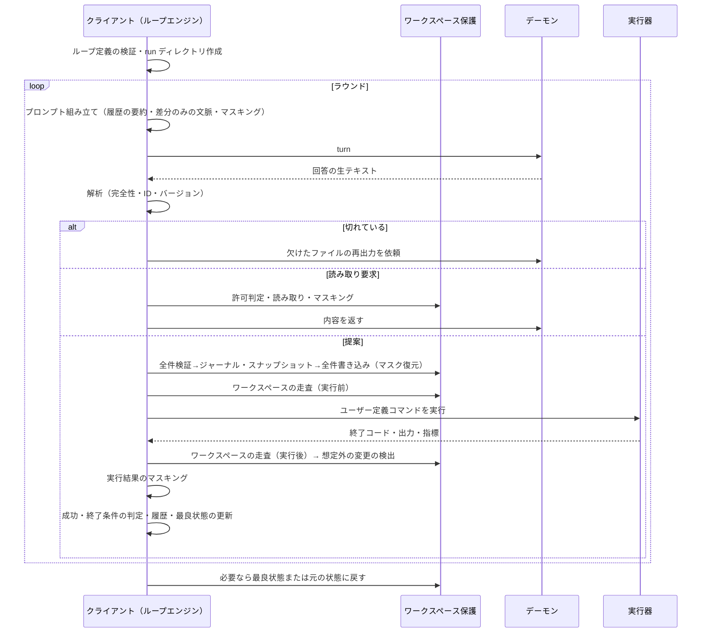

# アーキテクチャ

> **状態: 暫定版**。実物で確かめる仮説は plan.md 5.2 にまとめた。PoC の結果を受けて確定・修正する。

## 1. 方針

1. **デーモンは「チャットの 1 往復」だけを担う**。ブラウザ・ログイン状態・順番待ちのキュー・送信回数の計数を持つ。作業ディレクトリ（ワークスペース）には触らない。デーモンが読み書きするのは、`%LOCALAPPDATA%\llmc\daemon\` の下の、クライアントが用意した添付用の一時ファイル（マスキング済み）と、ダウンロードしたファイルの置き場だけ
2. **ファイルの読み書き・実行・ループはクライアント側のプロセスで行う**。作業ディレクトリ・許可リスト・ロールバックは、コマンドを実行したユーザーの文脈（カレントディレクトリ、ループ定義）に属するため
3. **画面操作は `ChatBackend` インタフェースの裏に隠す**。Playwright による実装は、サイト別プロファイル（YAML）を読む汎用のドライバとする。Copilot 固有の差は Copilot 用プロファイルに閉じ込める
4. **書式の規則の原本は 1 つ**。プロンプト用の規則とエージェントの指示文は、そこから生成する
5. **llmc の状態は作業リポジトリの外に置く**。`%LOCALAPPDATA%\llmc\` に集め、権限を本人だけに絞る
6. **保護の境界を明示する**。llmc が守れるのは、llmc 自身が書き込むファイルまでである。ユーザー定義のコマンドで実行される AI のコードは、llmc の保護（許可リスト、変更禁止、スナップショット）の外で動く。この境界での対策（実行前後のワークスペースの走査、評価をワークスペースの外で行うことなど）は spec-security と spec-loop で定める

## 2. コンポーネント



| コンポーネント | 責務 | 主な仕様書 |
|---|---|---|
| CLI | 引数の解析、入出力の文字コード、終了コード、JSON 出力、実行 ID の発行 | spec-shell-integration |
| TUI | 画面表示、入力、スラッシュコマンド | spec-tui |
| プロンプト組み立て | タスク・文脈・履歴・規則を、入力欄の上限（予算）に収まるように組み立てる | spec-loop、spec-agent |
| マスキング | 送信前の置換（本文、文脈ファイル、添付用の一時ファイル、実行結果、読み取りの返答）と、書き込み時の復元（マスクを作ったファイルの中だけ） | spec-security |
| ファイル書式 | 回答の解析、文脈ファイルの埋め込み、エラーの分類と再依頼文の生成 | spec-file-protocol |
| ワークスペース保護 | パスの正規化と許可判定、文字コードと改行の保持、全件書き込みか全件取り消しか、ジャーナルとスナップショット、実行前後のワークスペースの走査 | spec-file-protocol、spec-loop、spec-security |
| ループエンジン | ラウンドの状態遷移、成功・終了条件、指標、履歴、最良状態 | spec-loop |
| 変換エンジン | UC5 の方式の選択、出力の検証、レシピ | spec-convert |
| 実行器 | ユーザー定義のコマンドの起動、タイムアウト、プロセスツリーの終了、出力の収集 | spec-loop、spec-security |
| IPC サーバ・キュー | 要求の受け付け、直列化、進捗イベントの配信、キャンセル、送信回数の上限（NFR-14）の確認 | spec-daemon |
| ChatBackend | 共通インタフェース（会話・送信・ストリーム・抽出・添付・ダウンロード） | spec-browser-driver |
| Playwright ドライバ | サイト別プロファイルに従う画面操作 | spec-browser-driver |
| 人が送信する方式 | クリップボード経由で、利用者が貼り付け・送信・コピーをする `ChatBackend`（自動操作の送信が拒否される個人の Copilot 用） | spec-browser-driver 13 章 |
| 認証監視 | ログイン状態の判定、セッション切れの検知 | spec-auth |

## 3. プロセス構成

| プロセス | 起動方法 | 寿命 | 備考 |
|---|---|---|---|
| クライアント | ユーザー・スクリプト・タスクスケジューラ | コマンド 1 回分 | `llmc.exe`（venv の console script） |
| デーモン | クライアントが必要に応じて自動起動、またはログオン時に自動起動 | アイドル時間の上限（既定 2 時間）で自動終了 | `pythonw.exe` でコンソールを持たない。1 ユーザーに 1 つ。クライアントがジョブの中（タスクスケジューラなど）で動いている場合も一緒に終了させられないよう、ジョブから切り離して起動する（`CREATE_BREAKAWAY_FROM_JOB`。許されない場合の扱いは spec-daemon）。`pythonw` の下で Playwright のドライバが起動できるかは実装の初期に確かめる |
| ブラウザ（画面ありの Edge、最小化） | デーモンが起動 | デーモンと同じ | persistent context。プロファイルは `%LOCALAPPDATA%\llmc\profiles\<site>`。組織の PC ではヘッドレスがポリシーで禁止されている（回避しない）。人が送信する方式のサイトでは起動しない |
| ユーザー定義のコマンド | 実行器が起動 | タイムアウトまで | Job Object に入れ、終了時にプロセスツリーごと終了する |
| 手元変換のスクリプト（UC5 方式 C） | 実行器が起動 | タイムアウトまで | 確認または事前承認が必須 |

`llmc login` は、常駐しているブラウザのウィンドウを元に戻してログインの画面を出す（ブラウザは常に画面ありなので、デーモンを止める必要は無い。spec-auth）。人が送信する方式（spec-browser-driver 13 章）はクライアントのプロセスの中で動き、デーモンを経由しない。

## 4. プロセス間通信

- 方式: **名前付きパイプ**（`\\.\pipe\llmc-<ユーザー SID>`）。接続は本人だけに限る（DACL と、`%LOCALAPPDATA%\llmc\daemon\` にある認証キーの両方）。詳細と localhost TCP との比較は spec-daemon
- spec-daemon・tech-selection への申し送り
  - 標準ライブラリ（`multiprocessing.connection`）で作るパイプは既定の DACL になり、Everyone と匿名に読み取りを許す。DACL を指定するには pywin32 か ctypes が要る
  - パイプ名は推測できるので、他のユーザーが先に同じ名前のパイプを作る「乗っ取り」を防ぐ。サーバは `FILE_FLAG_FIRST_PIPE_INSTANCE` で作り、クライアントは接続先のサーバのプロセスの所有者 SID が自分であることを確かめてから認証キーを使う
  - 取り消し（FR-COM-11）とキューの状態の配信には、送受信とブラウザの操作を並行させる構成が要る。Playwright の同期 API はスレッドをまたいで使えないので、非同期 API を使うか、ブラウザの操作を 1 つのスレッドに閉じ込める
- 形式: 長さ付きの JSON メッセージ。要求 1 件に対し、進捗イベントが複数件、最後に結果が 1 件
- 主な要求

| 要求 | 内容 |
|---|---|
| `health` | デーモン・ブラウザ・ログインの状態、キューの長さ、サイト別プロファイルのバージョン |
| `turn` | 実行 ID、会話の指定（新規・URL で続行）、エージェントの指定、本文、添付（クライアントが `daemon\staging\` に置いたマスキング済みの一時ファイル）、抽出の指定、タイムアウト |
| `cancel` | 実行中またはキュー中の `turn` を取り消す |
| `conversations` | 会話の一覧（サイトが対応する場合） |
| `download` | 回答中のファイルをダウンロードし、デーモンのダウンロード用ディレクトリに置いてパスを返す（クライアントが保存先へ移す） |
| `shutdown` | デーモンの終了 |

- 進捗イベント: `queued` → `sending` → `sent` → `first_token` → `delta`（複数回） → `completing` → `extracting` → 結果。名前と意味は spec-browser-driver 2.3 を正とする
- **会話は要求ごとに指定する**。キューで他の要求が間に入っても、ドライバが指定の会話（URL）へ移ってから送るので、ループのラウンドが他の会話に混ざらない

## 5. データフロー

### 5.1 単発の問い合わせ（UC2）



### 5.2 ループ（UC3）



## 6. ディレクトリ構成

### 6.1 ユーザーごとのデータ（`%LOCALAPPDATA%\llmc\`、本人だけに権限）

```
%LOCALAPPDATA%\llmc\
  config.yaml              利用者の設定（既定のサイト、エージェント、マスキングの共通規則など）
  sites\                   サイト別プロファイルの上書き（同梱の既定値に重ねる）
  profiles\<site>\         ブラウザのプロファイル（SSO の Cookie を含む）
  daemon\                  認証キー、PID ファイル、ログ、送信回数の記録
    staging\               添付用の一時ファイル（クライアントがマスキングして置く。送信後に削除）
    downloads\             ダウンロードしたファイル（クライアントが保存先へ移す）
  journal\                 ループ以外の書き込みのジャーナルとスナップショット（llmc undo 用）
  agents\                  llmc agent build の既定の出力先
  logs\                    クライアントのログ（実行 ID ごと）
  diag\                    画面の不具合の報告（スクリーンショット、DOM の断片）。既定で 7 日後に削除
  history\                 対話の履歴（UC1）
  runs\<プロジェクト>\<run-id>\   ループと変換の記録（既定の置き場所）
  recipes\                 利用者のレシピ
```

- ローミングプロファイルで同期されないよう、`%APPDATA%` ではなく `%LOCALAPPDATA%` を使う
- 作業リポジトリには、ユーザーが書いたループ定義やレシピ以外、llmc は何も置かない（`.git/info/exclude` への追記も不要）

### 6.2 llmc のリポジトリ（実装時の想定）

```
src/llmc/
  cli/  tui/  client/  daemon/
  backend/            ChatBackend インタフェース
    playwright/       汎用ドライバ
    manual/           人が送信する方式（クリップボード）
    sites/            同梱のサイト別プロファイル（copilot-m365.yaml など）
  protocol/           ファイル書式の解析器・生成器
    rules/v1/         規則の原本
  workspace/          パス判定・書き込み・スナップショット
  loop/  convert/  exec/  security/
agents/<名前>/        生成したエージェントの指示文と構成（手作業で画面に反映）
docs/
tests/                モックページ、書式の境界値、文字コード
```

## 7. 拡張点

| 拡張点 | 方法 |
|---|---|
| 別のチャットサイト | サイト別プロファイルを追加。DOM の構造が大きく違う場合のみ、ドライバに「フック」（サイト専用の小さな関数）を追加する |
| API が使えるようになった場合 | `ChatBackend` の別実装を追加。デーモンを経由するかどうかは実装が選べる |
| OpenAI 互換のエンドポイント（スコープ外） | デーモンに HTTP の受け口を追加し、`turn` に変換する。キューと認証はそのまま使える |
| 新しい書式のバージョン | `protocol/rules/v2` と解析器を追加。回答のバージョン表記で解析器を選ぶ |

## 8. 主な設計判断

| 判断 | 採用 | 主な理由 | 退けた案 |
|---|---|---|---|
| ループの実行場所 | クライアント | ファイルシステム・カレントディレクトリ・確認の UI がクライアント側にある。デーモンを薄く保ち、異常の影響を小さくする | デーモン内で実行（ターミナルを閉じても続くが、権限と状態が混ざる） |
| 状態の保存場所 | `%LOCALAPPDATA%\llmc` | 秘密情報を作業リポジトリに置かない（参考実装 #6・#11） | リポジトリ内の作業ディレクトリ |
| ロールバック | スナップショット（元のバイト列） | git の有無に依存せず、ユーザーの履歴を変えない（参考実装 #6・A9） | git のコミットと `reset --hard` |
| 同時実行 | 直列キュー | 本人の 1 アカウントで並列にしても、レート制限に当たるだけで利点が少ない | 複数タブで並列 |
| IPC | 名前付きパイプ | Windows で他ユーザーからの接続を OS の権限で絞れる。ポートの競合が無い | localhost TCP（spec-daemon で比較） |
| 送信回数の計数 | デーモン | 送信は必ずデーモンを通るので、1 か所で数えられる | クライアントごとに数える |
