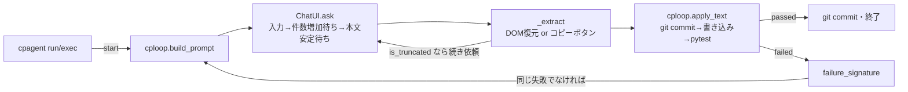

# 参考実装のレビュー

## 0. 概要

- 対象: 社内チャットの Web 画面を Playwright で操作し、コーディングループ（UC4）を回す試作品の 2 ファイル
  - `cploop.py`（289 行）: プロンプト生成、回答の解析と適用、pytest 実行、undo。手動モードはクリップボード経由
  - `cpagent.py`（408 行）: ブラウザ操作でループを無人実行。サブコマンドは login / probe / run / exec
- 目的: 仕組みと設計判断を評価し、llmc に**引き継ぐもの・作り直すもの・捨てるもの**を決める。名前とコード構成は引き継がない
- 行番号は参考実装のファイル上の位置（本リポジトリには参考実装を登録していない）
- 結論（詳細は 4 章）
  - **思想は引き継ぐ**: login と probe の分離、設定の外出し、全文置換と終了マーカー、変更禁止、連続失敗での停止、stdout と stderr の分離と終了コード
  - **実装はほぼ全面的に作り直す**: 解析器、パスの判定、書き込み、回答の特定と完了判定、ロールバック、ロック、文字コード処理
  - **捨てる**: クリップボード手動モード、pytest 固定の処理、`git add -A` と `reset --hard` による状態管理、`git ls-files` の送信

## 1. 構成の把握



状態は `.cploop/`（state.json、ログ、トランスクリプト、ブラウザプロファイル、ロック）に置き、ロールバックは git のコミットで実現している。

## 2. キックオフ資料の問題点 13 件の検証

| # | 問題 | 検証 | 根拠（行） | 補足 |
|---|---|---|---|---|
| 1 | UC4 専用 | 確認 | cploop 29, 207–222 | `PYTEST_CMD` で固定。判定は終了コード 0 か否かの 2 値。指標、最適化の向き、履歴、最良状態の概念が無い |
| 2 | 変更禁止の抜け道 | 確認 | cploop 163–165, 188–190 | `is_protected` は正規化前の文字列で判定し、その後に `safe_path` で解決している。`src/../tests/test_foo.py` は `tests/` に前方一致しないため通る。変更禁止リストの側も正規化しないので、`./tests` や `tests\` と指定すると一致しない。`.git` の判定（158）は大文字小文字を区別するので `.GIT/config` が通る |
| 3 | 抽出で壊れる | 確認 | cploop 33–37, 133 / cpagent 56–79 | `=== FILE: パス ===` と `=== DELETE: パス ===` がコードブロックの外にあり、`__init__.py` は太字に、`*` や `_` を含むパスも壊れる。DOM 復元は `<pre>` を必ず ``` で閉じて出力するため、未完のブロックも完成した形になる |
| 4 | 入れ子フェンス | 確認 | cploop 133 | 本文は `(.*?)\n```` の非貪欲一致で、最初の行頭 ``` で終わる。Markdown ファイル内の ```py で切れることを実際に確認した（本文が `# x` だけになる） |
| 5 | 文字コードと改行 | 確認 | cploop 106, 191 | 読み込みは UTF-8 固定で、Shift_JIS のファイルは `UnicodeDecodeError` で**プロンプト生成の段階で異常終了**する。`write_text` は Windows ではテキストモードで `\n` を CRLF に変換する。BOM も失われる。さらに末尾に必ず改行を 1 つ足す（191）ので、末尾改行の無いファイルが毎回変わる |
| 6 | git の扱い | 確認・**重大度を上げる** | cploop 184, 212, 225–229, 66–71 / cpagent 306 | `add -A` は未追跡の秘密ファイルを含めてコミットする。`undo` は直前のコミットのメッセージから戻り先を推測して `reset --hard` するので、ユーザーのコミットを消し得る。`checkout -B` は既存ブランチを付け替える。worktree では `.git` がファイルのため除外設定が書かれず、`.cploop/` ごとコミットされる。その中には**ブラウザのプロファイル（SSO の Cookie）**がある（#11 と重なり認証情報が git 履歴に入る） |
| 7 | 状態更新の優先順位 | 確認 | cploop 200 | `old \| (new - skipped) - deletes` は `-` が先に評価され `old \| ((new - skipped) - deletes)` になる。`old` 側から削除ファイルが除かれず、次のラウンドで「(未作成)」として送られる（実際に評価して確認） |
| 8 | 送る情報が多すぎる | 確認 | cploop 98–107 | 毎ラウンド `git ls-files` の最大 200 行と対象ファイル全文を送る。マスキングは無い。送る総量の上限も無い（ログだけ 6000 文字で切る） |
| 9 | 回答の特定が脆い | 確認 | cpagent 161–181 | メッセージ要素数の増加を待つ方式。仮想スクロールで古い要素が消えると件数が増えない。自分のメッセージも一致すると、自分の発言を回答として扱う（追加指摘 A2 で具体例）。画面上のエラー表示やレート制限の検知は無い |
| 10 | 多重起動の防止 | 確認 | cpagent 267–274, 316 | `O_EXCL` のロックファイルは `finally` で消すが、強制終了や電源断で残る。PID を書いているのに生存確認をしない |
| 11 | プロファイルの置き場所 | 確認 | cpagent 87 | 既定が作業リポジトリ内の `.cploop/browser-profile`。相対パスなので、リポジトリごとに別プロファイルになり、ログインもリポジトリごとに必要 |
| 12 | クリップボード依存 | 確認 | cploop 49–62 / cpagent 107, 156 | 手動モードはクリップボードに依存し、ユーザーのクリップボードを上書きする。ブラウザ側でもコピーボタン方式で OS のクリップボードを経由するので、無人実行中にユーザーがコピーした内容と競合する |
| 13 | 常駐しない・不適切な文言 | 確認 | cpagent 216–217 / cploop 44 | 実行ごとにブラウザを起動する。RULES に「実行環境があれば pytest を実行」とあり、社内チャットでは意味が無いうえ、AI が「実行して通った」と誤った報告をする誘因になる |

## 3. 追加の指摘

重大度: **高** = 誤ったファイルの書き込み、成功の偽装、データ消失、秘密情報の漏えいにつながる / **中** = 停止や誤動作 / **低** = 品質

### 3.1 高

**A1. 続きの依頼を上限まで使っても切れたままなら適用する**（cpagent 226–233）
`for _ in range(a.max_continues)` を抜けたあと `is_truncated` を確認し直さずに `apply_text` に進む。途中で切れたファイルがそのまま書き込まれる。さらに、続きの回答を前の回答に連結して判定する（230）ので、続きの側に `=== END ===` が 1 つあれば全体が「完全」とみなされ、前半で切れたファイルを AI が出し直さなかった場合も検出できない。
→ llmc では、ファイルごとの完全性を確認し、完全なファイルだけを採用する。上限に達して欠けたファイルがあれば、書き込まずに形式違反として扱う。

**A2. 自分のメッセージを回答として取り込み、成功に見せかける**（cpagent 161–180, cploop 31–45, 147–150）
`message_selector` が自分のメッセージにも一致すると、送信直後に件数が増えて待ちが終わり、取り出されるのは自分のプロンプトになる。プロンプトには現在のファイル内容が FILE ブロックとして入っており、RULES の文中に `=== END ===` という文字列があるので `is_truncated` も偽になる。結果として**元の内容を書き戻してテストを実行**し、既に通るテストなら「成功」でコミットする。
→ 回答の特定は発言者の属性で行い、終了マーカーは「プロンプト中に現れない、リクエストごとの nonce を含む形」にする。

**A3. 変更禁止をテストの設定で回避できる**（cploop 163–165, 207）
`tests/` を変更禁止にしても、AI はリポジトリ直下に `conftest.py`、`pytest.ini`、`pyproject.toml`（`addopts = -k nothing` など）を書ける。pytest はこれらを読み込むので、テストを飛ばしたり結果を書き換えたりして「成功」にできる。さらに `cpagent.json`（URL・セレクタ）や `.vscode/tasks.json`、`sitecustomize.py` など、**次の実行やエディタの動作を変えるファイル**も書ける。拒否リスト方式の限界である。
→ 書き込みは許可リスト方式にする。評価に影響するファイル（評価スクリプト、その設定、指標を出すファイル）を変更禁止に入れるよう、ループ定義の検証で警告する。llmc 自身の設定と作業ディレクトリは常に書き込み不可にする。

**A4. 例外が捕まらず、終了コードの意味が衝突する**（cpagent 261, 43）
`except TimeoutError` は Python 組み込みの `TimeoutError` だけを捕まえる。Playwright のタイムアウト（`playwright.sync_api.TimeoutError`）は `playwright.Error` の派生で、組み込みの `TimeoutError` の派生ではない。`page.goto`、`click`、`inner_text` などのタイムアウトは捕まらず、Python は終了コード **1** で終わる。これは `EXIT_MAX_ROUNDS` と同じ値で、呼び出し側は区別できない。JSON も出力されない。cploop の `apply` も、異常終了の 1 と「テスト失敗」の 1 が衝突する。
→ 終了コードは「想定外の内部エラー」を専用の値にし、最上位で全例外を捕まえて JSON に変換する。

**A5. パイプ出力時に Windows で異常終了する**（cpagent 286, 250, 263 / cploop 263–265）
Windows の Python は、コンソールに直接出す場合は Unicode で書けるが、**パイプやファイルにリダイレクトするとロケールの文字コード（cp932）**になる。`json.dumps(..., ensure_ascii=False)` の `message` に含まれる `✅` は cp932 で表せず `UnicodeEncodeError` になる（実際に確認）。非対話モードはまさにパイプやリダイレクトで使うので、成功したのに最後の出力で異常終了する。`sys.stdin.read()`（323）も cp932 で読むので、UTF-8 で渡されたタスク文が文字化けする。
→ 入出力の文字コードを明示的に決め（spec-shell-integration）、出力に絵文字を使わない、または表せない文字を置換する。

**A6. テスト実行にタイムアウトが無い**（cploop 207）
AI が書いたコードが無限ループや入力待ちになると、ループ全体が止まったままになる。ロックも残る（#10）。
→ 実行器でタイムアウトを必須にし、超過したらプロセスツリーごと終了する（Windows では Job Object などを使う）。

**A7. 送信前のマスキングが無く、記録にも生のまま残る**（cploop 106 / cpagent 188–192, 113–115）
設定ファイル内のパスワードやトークンがそのまま送信される（#8）。加えて、トランスクリプトと `not_ready.png`（画面のスクリーンショット）も作業リポジトリ内に平文で残り、#6 の経路でコミットされ得る。
→ マスキングは送信前に必ず通す。記録はユーザーごとのデータディレクトリに置き、スクリーンショットの保存は任意にする。

### 3.2 中

**A8. 書き込みの途中で失敗すると中途半端な状態が残る**（cploop 187–199）
複数ファイルを順に書き込む途中で `safe_path` が `ValueError` を出すと、捕まえる所が無い。一部のファイルだけ書き換わった状態で異常終了し、`state.json` も更新されない。
→ 書き込み前に全ファイルを検証し、全件が通った場合だけ書き込む（一時ファイルに書いて置き換える）。

**A9. undo で元に戻らないものがある**（cploop 225–229）
`reset --hard` は追跡済みのファイルしか戻さないので、AI が新しく作った未追跡のファイルは残る。`state.json`（ラウンド番号、対象ファイル一覧）は除外されているため戻らない。テストが失敗したラウンドの後にもう一度 apply すると、失敗したラウンドの内容が「before apply」としてコミットされ、undo は 1 段しか戻れない。
→ ラウンドごとに、書き込み前の元のバイト列と「新規作成したファイルの一覧」を保存し、それを使って戻す。

**A10. 形式違反の後の再依頼でタスクが失われる**（cpagent 246）
再依頼の文面は「出力形式が守られていません」と RULES だけ。`--fresh-chat-each-round` と組み合わせると、新しいチャットにタスクの説明も文脈も届かない。
→ 再依頼の文面は、チャットを続けるか新しくするかに応じて組み立てる。新しいチャットでは常に完全な文脈を送る。

**A11. 同じ失敗かどうかの判定が不安定**（cpagent 195–198, 253–256）
- `FAILED`、`ERROR`、`E ` で始まる行が 1 つも無い場合（収集エラーの形式違い、異常終了、タイムアウト）は空文字列のハッシュになり、**別々の失敗がすべて同じ失敗**と判定される
- 逆に、行番号、一時ファイルのパス、メモリアドレス、時刻が毎回変わる失敗は、いつまでも同じ失敗とみなされない
- `same_count` は初回が 0 なので、`--max-same-failure 2` だと同じ失敗が **3 回**続いて止まる（ヘルプの「この回数続いたら」と 1 ずれる）
→ 失敗の同一性は、抽出の正規表現と正規化の規則（数値・パスの置換など）をループ定義で指定できるようにする。署名を取り出せなかった場合は「不明」として扱い、同一とはみなさない。

**A12. 生成完了の判定が早すぎることがある**（cpagent 170–181, 135–137）
本文が `stable_seconds`（既定 4 秒）変化しなければ完了とみなす。生成中表示のセレクタを設定していない場合や、AI が考えている間に本文が止まる画面では、途中で完了と誤判定する。`_busy` は `.first.is_visible()` で、要素が無いと即座に偽になる。
→ 完了は「停止ボタンの消滅」「コピーボタンなど完了後にだけ現れる要素の出現」「本文の安定」の組み合わせで判定し、どの条件を使ったかを記録する。

**A13. コピーボタンの抽出が不確実**（cpagent 152–156）
`copy_button_selector` の `.last` は、メッセージ全体のコピーボタンではなく、**最後のコードブロックのコピーボタン**に一致し得る。その場合はコードブロック 1 つ分しか取れない。クリック後の待ちは固定の 0.5 秒で、クリップボードの更新を確認しない。直前の内容を読む可能性がある。
→ コピー前にクリップボードへ既知の値を入れておき、変化を確認する。取れたテキストが DOM の本文と大きく食い違う場合は、抽出の失敗として扱う。

**A14. 送信できたことを確認しない**（cpagent 139–150, 125–130）
入力後に送信ボタンを押す、または Enter を押すが、送信ボタンが無効な状態（入力欄の上限超過、前の生成中）を確認しない。送信されたこと（入力欄が空になる、自分のメッセージが現れる）も確認しない。`new_chat` は、入力欄が既に存在するので待ちが即座に終わり、固定の 1 秒待ちに頼っている。
→ 各操作の後に、期待する画面の変化を条件として待つ。

**A15. Windows 固有のパスの抜け道**（cploop 153–160）
`resolve()` と親ディレクトリの比較だけでは、次のものを防げない。
- 末尾のドットや空白（`tests./x.py`、`tests /x.py`）: Win32 API が名前を切り詰めて `tests\x.py` に書かれ得る
- 代替データストリーム（`a.py:hidden`）
- 予約デバイス名（`CON`、`NUL`、`COM1` など。拡張子付きも含む）
- 8.3 形式の短い名前（`TESTS~1\x.py`）
- ドライブ相対パス（`C:foo`）や UNC パス
- 既存のジャンクションやシンボリックリンク。判定は通っても、判定と書き込みの間に差し替えられる余地がある
→ 文字列の段階で拒否する規則（禁止文字、予約名、末尾のドットや空白、`:`）を設け、そのうえで解決後のパスでも判定する（spec-file-protocol）。

**A16. ユーザーの環境を黙って変える**（cploop 66–71, 184 / cpagent 296–297）
- `.git/info/exclude` に `__pycache__/` などを、ユーザーに断らずに追記する
- 手動モードの `apply` は作業ツリーが汚れていても確認せず、ユーザーの作業中の変更を「before apply」としてコミットする
- `exec` は dirty 判定で `cpagent.json` を除外しているのに、その後の `git add -A` でコミットする。社内の URL がリポジトリに入る
- dirty 判定は `git status --porcelain` の 4 文字目以降で判定しており、日本語のファイル名（引用符付きで出力される）や名前変更（`a -> b`）を正しく扱えない
- git リポジトリ外では `git()` が `CalledProcessError` で異常終了する（cploop の apply）

**A17. 送る内容に上限が無く、増え続ける**（cploop 95–115, 200）
送る全文に上限が無い。ファイルの文字コードやバイナリかどうかも確認しない（バイナリを指定すると異常終了する）。対象ファイル一覧は AI が作ったファイルを加えて増え続けるので、プロンプトがラウンドごとに大きくなり、いずれ入力欄の上限に当たる。

### 3.3 低

- **A18.** `parse_response` は辞書で、同じパスのブロックが 2 回あると後ろが黙って勝つ（cploop 139）。警告が無い
- **A19.** `BLOCK_RE` は、マーカー行とフェンスの間に 40 文字以下の行を 3 行まで許す（cploop 133）。UI の言語ラベル対策だが、AI の短い説明文も読み飛ばす。また RULES の例は常に ```` ```python ```` で、言語に合わない
- **A20.** `start` が状態を 2 回保存している（cploop 121, 127）。`execute` の戻り値の型注釈（cpagent 282）が実態と合わない
- **A21.** `login` は `input()` で Enter を待つだけで、ログインできたかを確認しない（cpagent 343）
- **A22.** `exec` は `--headless` を付けないと画面ありで起動する（cpagent 92）。非対話モードの既定として不自然
- **A23.** 終了コード 4 が「ログイン切れ」と「セレクタの不一致」を兼ねている（cpagent 48–49, 119）。対処が全く違うので分けるべき

## 4. 判断: 引き継ぐもの・作り直すもの・捨てるもの

### 4.1 引き継ぐ（考え方を採用し、実装は新規）

| 項目 | 参考実装 | llmc での扱い |
|---|---|---|
| login と probe の分離 | cpagent 333–366 | `llmc login`（画面あり、ログイン完了を画面で確認）と `llmc probe`（セレクタ、抽出、書式の往復を診断し、結果を報告）。probe はセレクタの項目ごとに合否を出す |
| セレクタと抽出方式の外出し | cpagent 82–94 | サイト別プロファイル（Copilot 用など）として外出しする。JSON ではなく YAML とし、バージョンと検証用のスキーマを持たせる |
| 全文置換と終了マーカー | cploop 31–45 | 全文置換を基本とする。終了マーカーは回答全体とファイルごとの 2 段にし、nonce を含める |
| 続きの依頼 | cpagent 50, 226–230 | 欠けたファイルの名前を指定して出し直させる。上限に達しても欠けていれば書き込まない（A1） |
| 変更禁止 | cploop 163–165 | 正規化後に判定し、許可リスト方式と組み合わせる |
| 同じ失敗・形式違反の連続での停止 | cpagent 241–258 | ループ定義で条件を指定できるようにし、一般化する（A11） |
| 非対話モードの設計 | cpagent 17–26 | stdout に結果、stderr に進捗、JSON 出力、用途別の終了コード。内部エラーの専用コードを足す（A4） |
| ラウンドごとの記録 | cpagent 188–192 | run ディレクトリに、プロンプト（マスキング後）、回答、書き出したファイル、実行結果、指標を保存する |
| 多重起動の防止・作業ツリーの確認 | cpagent 267–303 | 多重起動はデーモンの直列キューで解消する。git 連携を使う場合だけ、作業ツリーの確認を行う |

### 4.2 作り直す

| 項目 | 理由 | 対応する仕様書 |
|---|---|---|
| 回答の書式と解析器 | #3、#4、A1、A2、A18、A19 | spec-file-protocol |
| パスの正規化と許可判定 | #2、A3、A15 | spec-file-protocol、spec-security |
| ファイルの書き込み | #5、A8 | spec-file-protocol |
| 回答の特定・完了判定・抽出 | #9、A12、A13、A14 | spec-browser-driver |
| ロールバックと最良状態 | #6、A9 | spec-loop |
| 実行器 | #1、A6 | spec-loop、spec-security |
| ロック・常駐 | #10、#13 | spec-daemon |
| プロファイルと認証 | #11、A21 | spec-auth |
| 送る内容の組み立て | #8、A7、A10、A17 | spec-loop、spec-security |
| 文字コードと終了コード | A4、A5、A23 | spec-shell-integration |

### 4.3 捨てる

| 項目 | 理由 |
|---|---|
| クリップボード経由の手動モード | #12。無人実行・リモートセッションで使えず、ユーザーのクリップボードを上書きする。手動で使いたい場合はファイル経由（プロンプトをファイルに出し、回答をファイルから読む）で代替する |
| pytest 固定の処理と pytest 用の失敗署名 | #1。UC4 の専用機能は作らない方針。UC4 はループ定義で表現する |
| git の `add -A`、`reset --hard`、`checkout -B` による状態管理 | #6、A9、A16。ユーザーの git 履歴と作業を壊し得る |
| `git ls-files` の送信 | #8。目的に不要で、社内の構成を送ってしまう |
| 「実行環境があれば pytest を実行」の文言 | #13。社内チャットに合わず、誤った報告を誘う |
| `.git/info/exclude` への追記 | A16。作業ディレクトリをリポジトリの外（ユーザーごとのデータディレクトリ）に置けば不要になる |

## 5. 後続の成果物への申し送り

1. ファイルごとの完全性は、LLM が数えられない行数の申告に頼らず、**nonce を含む終了行**を第一候補として spec-file-protocol で比較する
2. 回答の特定は**発言者の属性**を主にし、件数を数える方式は使わない（spec-browser-driver）
3. llmc の作業ディレクトリ・設定・ブラウザプロファイルは**作業リポジトリの外**に置く（spec-auth、architecture）
4. 評価をすり抜ける書き込み（A3）を、ループ定義の検証と許可リストで防ぐ方法を spec-security に書く
5. 終了コードに「内部エラー」「ログイン切れ」「セレクタ不一致」「確認が必要（非対話モード）」を分けて加える（spec-shell-integration）
6. PowerShell 5.1 で日本語をパイプするときの `$OutputEncoding` の問題と、Python の標準入出力の文字コード（A5）をまとめて扱う（spec-shell-integration）
