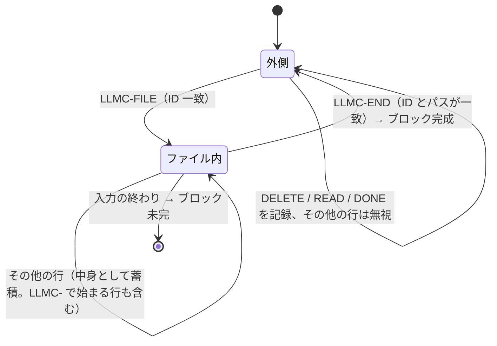
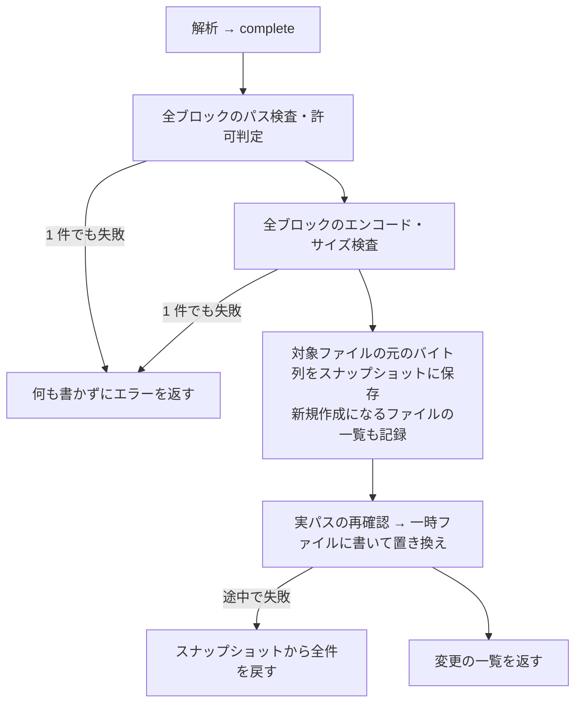

# ファイル入出力プロトコル仕様（llmc/1）

## 1. 目的と前提

- 画面操作では function calling を使えないため、**回答テキストの決まった書式**を解析して、ファイルの書き出し・削除・読み取り要求を扱う
- 回答は、コピーボタンで取れる生の Markdown（第一候補）か、描画後の DOM から復元したテキスト（次善）として届く。**どちらで届いても壊れない**ことを設計の条件とする
- 本書は書式（AI → llmc）、文脈の埋め込み（llmc → AI）、解析の規則、途中切れの検出、パスの許可と正規化、文字コードと改行の扱いを定める
- 書式の説明文（AI に渡す規則）の原本と、その配布の仕方は spec-agent で定める

## 2. 設計の要点

| 要件 | 解決方法 |
|---|---|
| Markdown として描画されても壊れない | すべてのメタ情報（パスなど）は**コードブロックの内側の行**に書く。コードブロックの中身は描画されないので、`__init__.py` も壊れない。info 文字列は DOM 復元で失われることが多いので頼らない |
| 入れ子のコードフェンスに耐える | ファイルの範囲は**フェンスではなく、内側の開始行と終了行**で決める。フェンスは描画を守るためだけに使い、長さを可変にする |
| 途中で切れたことを検出できる | 回答全体の終了行に加えて、**ファイルごとの終了行**を必須にする。どちらにも、リクエストごとに発行する ID（nonce）を入れる |
| 自分のメッセージや古い回答を取り違えない | 終了行の ID は送信ごとに変わる。プロンプトには ID を「値」としてだけ書き、終了行の完成形を書かないので、自分のメッセージに一致しない |
| 描画で閉じられた未完のブロックを書き込まない | ファイルの終了行が無いブロックは、フェンスが閉じていても未完として扱う |
| AI は行数を正確に数えられない | 行数の申告は任意の補助情報にとどめ、不一致は警告だけにする |

## 3. 用語

| 用語 | 意味 |
|---|---|
| ターン | llmc の送信 1 回と、それに対する回答 1 回 |
| ターン ID | ターンごとに llmc が発行する 6 文字の ID。英大文字と数字から、紛らわしい文字（`0 O 1 I L`）を除いた 31 文字で作る（例: `K7Q2MX`）。約 8.9 億通り |
| 指示行 | `LLMC-` で始まる 1 行。行頭・行末の空白は無視する |
| ファイルブロック | `LLMC-FILE` 行から、同じ ID とパスを持つ `LLMC-END` 行までの範囲 |
| ワークスペース | 書き込みと読み取りの基準になるディレクトリ。ループではループ定義の `workspace`、それ以外ではカレントディレクトリか `-o` の場所 |

## 4. 回答の書式（AI → llmc）

### 4.1 全体

`````text
（説明文は自由。ただし必要最小限）

````yaml
LLMC-FILE id=K7Q2MX path="config/app.yaml" lines=3
server:
  workers: 8
  timeout: 30
LLMC-END id=K7Q2MX path="config/app.yaml"
````

````text
LLMC-DELETE id=K7Q2MX path="config/old.yaml"
````

## 変更点
- workers を 4 から 8 に増やした

```text
LLMC-DONE v=1 id=K7Q2MX rev=3fa9c1 files=1 deletes=1 reads=0
```
`````

### 4.2 指示行の一覧

| 指示行 | 書式 | 置く場所 |
|---|---|---|
| ファイルの開始 | `LLMC-FILE id=<ID> path="<相対パス>" [lines=<N>]` | コードブロックの内側の 1 行目 |
| ファイルの終了 | `LLMC-END id=<ID> path="<相対パス>"` | 同じコードブロックの内側の最終行 |
| 削除 | `LLMC-DELETE id=<ID> path="<相対パス>"` | コードブロックの内側 |
| 読み取り要求 | `LLMC-READ id=<ID> path="<相対パス>" [head=<N>] [tail=<N>] [lines=<A>-<B>] [grep="<正規表現>"]` | コードブロックの内側 |
| 回答の終了 | `LLMC-DONE v=<版> id=<ID> [rev=<規則の版>] files=<N> deletes=<N> reads=<N>` | 回答の最後。コードブロックの内側を推奨（外側でも受け付ける） |

- 属性の値は、空白を含まない場合は引用符を省略できる。`path` は常に `"` で囲むよう依頼するが、省略も受け付ける
- `path` の中に `"` は使えない（Windows のファイル名でも使えないため、エスケープの規則は設けない）
- 属性の順序は自由。知らない属性は無視し、警告を記録する（前方互換のため）
- 削除・読み取り・回答の終了の指示行は、1 つのコードブロックにまとめて書いてよい

### 4.3 フェンスの規則（AI への依頼）

- ファイルブロックは**バッククォート 4 個以上**のフェンスで囲む。ファイルの中にバッククォートが 4 個以上連続する箇所があれば、それより長くする
- info 文字列（言語名）は任意。ハイライト用に書いてよいが、llmc は使わない
- チルダのフェンス（`~~~~`）も受け付ける。どちらを推奨するかは、実際の画面での描画を確かめて決める（open-questions）

解析はフェンスに依存しない（6 章）ので、AI がフェンスの長さを誤っても、**コピーボタンで取った場合はファイルの中身は正しく取れる**。DOM から復元した場合は、フェンスの誤りで描画が崩れた箇所を検出して未完として扱う（6.4）。

### 4.4 ファイルの中身の範囲

- `LLMC-FILE` 行の次の行から、`LLMC-END` 行の前の行までが、ファイルの中身
- 中身の行の内容は一切変換しない（行頭の空白、タブ、行末の空白を保つ）。ただし改行コードは解析の時点で LF にそろえる（9 章で元に合わせる）
- 中身が 0 行の場合は空のファイルとする
- 最終行の後の改行の有無は、回答からは判断できない。元のファイルに合わせる（9.4）

## 5. 文脈の埋め込み（llmc → AI）

llmc が送る文脈ファイルは、回答の書式と**別の指示行**で埋め込む。自分のメッセージを回答として取り違えた場合でも、回答の書式として解析されないようにするためである。

`````text
````yaml
LLMC-CTX path="config/app.yaml" lines=3 masked=1 state=unchanged-since-round-2
server:
  workers: 4
  password: @@LLMC-MASK-0001@@
LLMC-CTX-END path="config/app.yaml"
````
`````

| 属性 | 意味 |
|---|---|
| `path` | ワークスペースからの相対パス |
| `lines` | 行数（llmc が数えるので正確） |
| `masked` | マスキングで置換した箇所の数（spec-security） |
| `range` | 一部だけ送る場合の範囲（`head=50`、`lines=100-180` など） |
| `state` | 同じチャットを続ける場合の、前回からの変化（`new`、`changed`、`unchanged-since-round-N`）。`unchanged` の場合は中身を省略し、この行だけを送る |

- フェンスの長さは llmc が計算する（中身の中で最も長いバッククォートの連続 + 1、最小 4）
- 読み取り要求への返答も同じ形式で返す。許可されなかった要求は `LLMC-CTX-DENIED path="..." reason="..."` で返す
- プロンプトの冒頭に、プロトコルの版とターン ID を**値として**書く。指示行の完成形（`LLMC-DONE ... id=K7Q2MX` のような文字列）はプロンプトに書かない

```text
llmc プロトコル: llmc/1（規則の版 3fa9c1）
このターンの ID: K7Q2MX
```

## 6. 解析の規則

### 6.1 入力

解析器は、ドライバから次のどちらかを受け取る（spec-browser-driver）。

| 入力 | 内容 | 位置づけ |
|---|---|---|
| 生テキスト | コピーボタンで取った Markdown | 第一候補 |
| 区分付きテキスト | DOM から復元した、`text` と `code`（`<pre>` 1 つにつき 1 区分。`textContent` で取り、改変しない）の区分の列 | 次善 |

### 6.2 手順

1. 改行を LF にそろえる。行頭の BOM、ゼロ幅文字（U+200B〜U+200D、U+FEFF）を指示行の判定のときだけ取り除く
2. 各行を、正規表現 `^\s*LLMC-(FILE|END|DELETE|READ|DONE)\b(.*)$` で指示行かどうか判定する。`LLMC-CTX` で始まる行は文脈の埋め込みであり、回答の指示行としては扱わない（見つかった場合は警告 `W_ECHOED_CONTEXT`）
3. 状態機械で処理する



- **ファイル内では、`LLMC-END`（ID とパスが一致するもの）以外の行はすべて中身として扱う**。これにより、ファイルの中に `LLMC-FILE` や ``` を含む文章（llmc 自身の説明書など）があっても壊れない
- ファイル内で、ID かパスが一致しない `LLMC-END` が現れた場合は中身として扱い、警告 `W_FOREIGN_END` を記録する
- ID が一致しない `LLMC-FILE` は無視し、`E_ID_MISMATCH` を記録する（古い回答や、AI が例を書き写した場合）

### 6.3 ターンの判定

解析の結果、ターンを次のどれかに分類する。

| 分類 | 条件 |
|---|---|
| `complete` | `LLMC-DONE` があり、ID が一致し、すべてのファイルブロックが完成し、`files`・`deletes`・`reads` の申告数が実際の数と一致する |
| `truncated` | `LLMC-DONE` が無い、または未完のファイルブロックがある |
| `invalid` | `LLMC-DONE` はあるが、申告数の不一致、パスの不正、重複などのエラーがある |
| `no_protocol` | 指示行が 1 つも無い（普通の文章の回答） |

- `files` の申告数より実際の完成ブロックが少ない場合は `truncated` ではなく `invalid`（`E_COUNT_MISMATCH`）とする。DONE が書かれている以上、回答は最後まで届いているので、AI の書き漏れとして扱う
- `no_protocol` を形式違反とするかどうかは、呼び出し元（ループ、変換、対話）が決める

### 6.4 DOM から復元した場合の追加の規則

- ファイルブロックの開始行と終了行が、**同じ `code` 区分の中**にあること。別々の区分にまたがる場合（AI のフェンスの長さの誤りで描画が分断された）は `E_SPLIT_BLOCK` として未完扱いにする
- `LLMC-DELETE` と `LLMC-READ` は `code` 区分の中にあるものだけを採用する。`text` 区分のものは、描画でパスが壊れている恐れがあるので `E_RENDERED_DIRECTIVE` とする
- `LLMC-DONE` は `text` 区分にあっても採用する（パスを含まず、記号も `=` だけなので描画で壊れない）

### 6.5 エラーと警告

エラーがあるターンでは、**1 件も書き込まない**（全件書き込むか、まったく書かないか）。

| コード | 意味 | 再依頼の文面（要旨） |
|---|---|---|
| `E_NO_DONE` | 終了行が無い（途中切れ） | 未完のファイル名を挙げて、そのファイルだけ出し直しを依頼 |
| `E_UNTERMINATED` | ファイルの終了行が無い | 同上 |
| `E_SPLIT_BLOCK` | ブロックが描画で分断された | フェンスをもっと長くして出し直しを依頼 |
| `E_ID_MISMATCH` | ID が違う（古い ID、`<ID>` のような書き写し） | 正しい ID を示して出し直しを依頼 |
| `E_COUNT_MISMATCH` | 申告数と実際の数が違う | 実際に検出したパスの一覧を示して確認を依頼 |
| `E_DUPLICATE_PATH` | 同じパスのブロックが 2 つ以上ある（正規化後に比較） | 1 つにまとめるよう依頼 |
| `E_PATH_INVALID` | パスの書き方が不正（8.2） | 理由を示す |
| `E_PATH_DENIED` | 書き込みの許可リストに無い | 許可されているパスの一覧を示す |
| `E_PROTECTED` | 変更禁止のパス | 変更禁止であることを示す |
| `E_BINARY_TARGET` | バイナリのファイルに書こうとした | テキストでは書けないことを示す |
| `E_ENCODING` | 元の文字コードで表せない文字がある | 該当する文字と行を示す |
| `E_TOO_LARGE` | 1 ファイル・1 ターンのサイズ上限を超えた | 上限を示す |
| `E_RENDERED_DIRECTIVE` | 描画される場所に書かれた指示行（DOM 復元時） | コードブロックの中に書くよう依頼 |
| `E_TOOL_ARTIFACT` | テキストではなく、ツールで作ったファイル（ダウンロードのリンク）が返った（ループでのみ） | テキストで出力するよう依頼（spec-agent 5.1） |
| `E_UNKNOWN_MASK` | このラン以外の、または存在しないマスクの置換文字列がある | — |
| `W_VERSION_MISMATCH` | `v` が違う、または無い | — （警告のみ。解析できれば続行） |
| `W_REV_MISMATCH` | `rev` が送った規則の版と違う | — （エージェントの指示文が古い可能性。spec-agent） |
| `W_LINES_MISMATCH` | `lines` の申告と実際の行数が違う | — （警告のみ） |
| `W_MIXED_READ_WRITE` | 読み取り要求とファイルブロックが同じターンにある | 7.3 |
| `W_ECHOED_CONTEXT` | 回答に `LLMC-CTX` 行がある | — |
| `W_FOREIGN_END` | ファイル内に、ID かパスが違う終了行がある | — |

### 6.6 続きの依頼と、完成したブロックの引き継ぎ

- `truncated` の場合、完成したファイルブロックはそのターンの「保留」として持ち、未完と未出力のファイルだけを出し直すよう依頼する（続きの依頼は新しいターン ID で送る）
- 続きの回答で同じパスが再び出力された場合は、新しい方を採用する
- 続きの依頼の上限（既定 2 回）に達しても `complete` にならない場合は、保留していたブロックも含めて**何も書き込まず**、形式違反として扱う
- 続きの依頼の回答には、元のターンの分も含めた合計数ではなく、**その回答の中の数**を `LLMC-DONE` に書かせる

## 7. 読み取り要求

### 7.1 書式

```text
LLMC-READ id=K7Q2MX path="logs/app.log" tail=200
LLMC-READ id=K7Q2MX path="logs/app.log" grep="ERROR|WARN" tail=50
```

- `head`、`tail`、`lines` は 1 つまで指定できる。何も指定しない場合は全体（サイズ上限まで）
- `grep` は Python の正規表現。一致した行だけを返し、`head`・`tail`・`lines` と組み合わせられる。不正な正規表現はエラーとして返す
- 1 ターンあたりの要求数と、返す内容の合計サイズに上限を設ける（ループ定義で指定。既定 5 件・20,000 文字）

### 7.2 許可と確認

| モード | 動作 |
|---|---|
| 対話（UC1） | 許可リストに合うものを一覧で示し、ユーザーが確認してから返す。合わないものは確認もせずに拒否する |
| ループ（UC3） | ループ定義で事前に許可した範囲だけを自動で返す。それ以外は `LLMC-CTX-DENIED` で返す |
| 非対話（UC2、UC5） | ループと同じ（事前に許可した範囲だけ）。許可が無ければすべて拒否する |

返す内容には、送信前のマスキングを必ず適用する。

### 7.3 読み取りと書き込みが同じターンにある場合

読み取り要求を先に処理して内容を返し、そのターンのファイルブロックは**書き込まない**。返答で「読み取った内容を踏まえて、改めて提案全体を出力してください」と依頼する。提案が読み取りの結果に依存している可能性が高いので、先に書かせないためである。

## 8. パスの許可と正規化

### 8.1 正規化の手順

AI が書いたパスと、ループ定義に書かれたパターンの両方に同じ手順を適用する。

1. Unicode の NFC 正規化
2. `\` を `/` に置き換える
3. 先頭の `./` を取り除き、連続する `/` を 1 つにする
4. 文字列としての検査（8.2）
5. 構成要素ごとに、比較用の値（casefold した値）を作る
6. 許可リストと変更禁止リストを、比較用の値で照合する（8.3）
7. ワークスペースの実パスと結合し、実在する親ディレクトリをたどってリンクを確認する（8.4）

### 8.2 文字列として拒否するもの（`E_PATH_INVALID`）

| 拒否するもの | 例 | 理由 |
|---|---|---|
| 空のパス、`/` で終わるパス | `""`、`src/` | ファイルを指さない |
| 絶対パス、ドライブ指定、UNC | `C:\x`、`C:x`、`/x`、`\\srv\x`、`\\?\C:\x` | ワークスペースの外 |
| `..` の構成要素 | `src/../tests/x` | 正規化で解決すれば許可判定はできるが、正当な用途が無いので一律に拒否する（参考実装 #2 の抜け道を構造的にふさぐ） |
| `:` を含む | `a.py:hidden`、`a.py::$DATA` | 代替データストリーム、ドライブ相対 |
| 制御文字、`< > " \| ? *` | — | Windows で使えない |
| 末尾がドットか空白の構成要素 | `tests./x`、`tests /x` | Win32 API が切り詰め、別のパスに書かれる |
| 予約デバイス名（拡張子付きも含む、大文字小文字を問わない） | `CON`、`nul.txt`、`COM1`、`LPT9`、`COM¹` | デバイスへの書き込みになる |
| 8.3 形式の短い名前に見える構成要素 | `TESTS~1` | 長い名前の変更禁止を回避できる。`~` の後に数字が続くものを拒否 |
| 構成要素 1 つが 255 文字超、全体が 240 文字超 | — | MAX_PATH の問題を避ける |

### 8.3 許可リストと変更禁止リスト

- パターンは gitignore 風（`*` は `/` をまたがない、`**` はまたぐ、末尾の `/` はディレクトリ以下全体）。ワークスペースからの相対パスで書く
- 照合は比較用の値（casefold）で行う
- 判定の優先順位: **常時禁止 > 変更禁止 > 書き込み許可**。どれにも当たらなければ拒否（許可リスト方式）
- 読み取りも同じ仕組みで、読み取り許可リストを使う。変更禁止のファイルは読み取りは許可できる（評価スクリプトを AI に見せるのは構わない、などの用途）

常時禁止（ループ定義で解除できない）:

| パターン | 理由 |
|---|---|
| `.git/**`、`.hg/**`、`.svn/**`、および `.git` という名前のファイル | リポジトリの管理領域 |
| ループ定義ファイル自身、レシピファイル、run ディレクトリ | 評価条件の書き換えを防ぐ |
| llmc の設定・サイト別プロファイル（ワークスペース内に置かれている場合） | 次回の動作の書き換えを防ぐ |
| `*.lnk`、`*.url`、`desktop.ini` | ショートカット経由の実行 |

既定で書き込み禁止の警告を出すもの（ループ定義で明示的に許可すれば書ける）:
`.vscode/**`、`.idea/**`、`.github/**`、`conftest.py`、`pytest.ini`、`tox.ini`、`setup.cfg`、`pyproject.toml`、`sitecustomize.py`、`usercustomize.py`、`*.pth`、`*.bat`、`*.cmd`、`*.ps1`、`*.exe`、`*.dll`（理由は spec-security）

### 8.4 実パスの確認

- ワークスペースの実パス（`GetFinalPathNameByHandle` で得た正式な表記）を基準にする
- 書き込み先の親ディレクトリを、ワークスペースから順にたどる。途中に**リパースポイント（シンボリックリンク、ジャンクション）がある場合は拒否**する（ループ定義で明示的に許可した場合を除く）
- 書き込み先が既に存在し、リパースポイントである場合も拒否する
- 確認は解析の直後と、**書き込みの直前の 2 回**行う（確認と書き込みの間の差し替えを狭める）
- 既存のファイルに読み取り専用属性がある場合は拒否する（属性を外して書くことはしない）

## 9. 文字コードと改行

### 9.1 既存ファイルの判定

| 順序 | 判定 | 結果 |
|---|---|---|
| 1 | ループ定義の `encoding` の指定（パターンごと） | 指定のとおり |
| 2 | BOM（UTF-8、UTF-16 LE/BE） | BOM のとおり。UTF-16 は v1 では読み取りのみ対応し、書き込みは `E_ENCODING` |
| 3 | NUL バイトを含む、または拡張子がバイナリの一覧にある | **バイナリ**（テキストとして送らず、書き込まない） |
| 4 | UTF-8 として厳密に復号できる | UTF-8（BOM なし）。ASCII だけのファイルもここに入る |
| 5 | cp932 として厳密に復号できる | Shift_JIS（cp932） |
| 6 | どれにも当たらない | 未対応（送らず、書き込まない） |

- 統計的な推定（charset-normalizer など）は使わない。判定の結果が毎回同じになるよう、決まった順序で判定する
- ASCII だけのファイルを UTF-8 と判定した後、AI が日本語を書いた場合は UTF-8 で書く。cp932 にしたい場合はループ定義で `encoding` を指定する

### 9.2 改行の判定

| ファイルの状態 | 判定 |
|---|---|
| CRLF だけ | CRLF |
| LF だけ | LF |
| 混在 | 多い方。警告 `W_MIXED_NEWLINE` を出す |
| 改行が無い（1 行だけ） | 新規ファイルの規則（9.3）に従う |

### 9.3 新規ファイル

ループ定義の `new_file_defaults` で、パターンごとに文字コード・BOM・改行・最終行の改行を指定できる。指定が無い場合の既定値:

| パターン | 文字コード | 改行 | 理由 |
|---|---|---|---|
| `*.ps1`、`*.psm1`、`*.psd1` | UTF-8（BOM 付き） | CRLF | PowerShell 5.1 は BOM の無いスクリプトを ANSI（cp932）として読むため |
| `*.bat`、`*.cmd` | cp932 | CRLF | cmd.exe はコードページで読むため |
| その他 | UTF-8（BOM なし） | LF | — |

### 9.4 書き込み

1. 中身（LF でそろえたもの）を、元のファイルの改行コードに変換する
2. 最終行の後の改行は、元のファイルにあれば付け、無ければ付けない。新規ファイルは既定で付ける
3. マスクの置換文字列を元の値に戻す（spec-security）
4. 元の文字コードでエンコードし、元のファイルに BOM があれば付ける。表せない文字があれば `E_ENCODING`
5. 中身が元のファイルとバイト単位で同じなら書き込まない（「変更なし」として記録）
6. 同じディレクトリの一時ファイルに書き、`os.replace` で置き換える
7. Python の `write_text` などテキストモードの書き込みは使わない（改行が変わるため）。すべてバイト列で扱う

### 9.5 送信時

- 文脈ファイルは判定した文字コードで復号して送る。文字コードは AI に知らせない（AI は常に Unicode のテキストとして扱えばよい）
- バイナリと未対応のファイルは送らず、`LLMC-CTX-DENIED path="..." reason="binary"` を送る

## 10. 書き込みの全体の流れ



- 削除は、スナップショットにバイト列を保存してから削除する
- スナップショットの形式と保存場所は spec-loop（run ディレクトリ）。ループ以外（UC1 の確認付き書き出し）でも同じ仕組みを使い、`llmc undo` で直前の書き出しを戻せる

## 11. 上限（既定値。ループ定義・設定で変更できる）

| 項目 | 既定値 |
|---|---|
| 1 ファイルの中身 | 200,000 文字 |
| 1 ターンのファイル数 | 20 |
| 1 ターンの合計 | 400,000 文字 |
| 続きの依頼の回数 | 2 |
| 読み取り要求 | 1 ターン 5 件、合計 20,000 文字 |

1 回の回答の長さには、チャット側の出力上限がある。上限は実際の画面で確かめる（open-questions）。

## 12. 差分形式を使うかどうか

| 観点 | 全文置換 | 差分形式（unified diff） | 置換ブロック（検索文字列と置換後） |
|---|---|---|---|
| AI の出力の正確さ | 高い | 低い（行番号や前後の行がずれやすい） | 中（検索文字列が完全一致しないことがある） |
| 途中切れの影響 | 1 ファイル単位で検出できる | 部分適用の危険 | 部分適用の危険 |
| 大きなファイル | 出力が長く、上限に当たりやすい | 短い | 短い |
| 文字コード・改行の保持 | 容易 | 容易 | 容易 |
| 検証 | 不要 | 適用できるかの確認が必要 | 一意に一致するかの確認が必要 |

**判断**: v1 は**全文置換のみ**とする。UC3 の主な対象である設定ファイルや SQL は小さく、全文置換の欠点が小さい。大きなファイルが必要になった場合は、v2 で置換ブロック（`LLMC-EDIT`）を追加する候補とする。差分形式は採らない。

## 13. 版の管理

- プロトコルの版は `llmc/<整数>`。指示行の文法やエラーの意味を変える場合に上げる。属性の追加（知らない属性は無視される）では上げない
- 規則の版 `rev` は、規則の原本（spec-agent）の内容から計算した短いハッシュ。文面を変えると変わる
- llmc はプロンプトに版と `rev` を書き、AI は `LLMC-DONE` に書き返す。不一致は警告（`W_VERSION_MISMATCH`、`W_REV_MISMATCH`）とし、解析できれば続行する
- 解析器は、回答の `v` に対応する解析器を選ぶ。対応していない版は `invalid` とする

## 14. 境界値の例（テスト計画で網羅する）

| 例 | 期待する結果 |
|---|---|
| Markdown ファイルの中に ``` と ```` を含む | 中身は正しく取れる（コピーボタン）。DOM 復元でフェンスが短すぎた場合は `E_SPLIT_BLOCK` |
| ファイルの中に `LLMC-END id=K7Q2MX path="other"` という行がある | 中身として扱う（パスが違う） |
| ファイルの中に、完全に一致する終了行がある | 終了とみなす（ID はターンごとの乱数なので、偶然には起きない。AI が意図的に書いた場合のみ） |
| `__init__.py` のパス | 壊れない（コードブロックの内側にある） |
| 回答が途中で切れ、描画でフェンスが閉じられた | `LLMC-END` が無いので未完 |
| `LLMC-DONE` はあるがファイル数が足りない | `E_COUNT_MISMATCH`、何も書かない |
| 自分のプロンプトを取り違えた | `LLMC-CTX` しか無いので `no_protocol`＋`W_ECHOED_CONTEXT` |
| `path="src/../tests/x"`、`"Tests/X.py"`（変更禁止 `tests/`）、`"tests./x"`、`"con.txt"`、`"a:b"` | それぞれ `E_PATH_INVALID` または `E_PROTECTED` |
| Shift_JIS・CRLF のファイルへの書き込み | Shift_JIS・CRLF のまま。表せない文字は `E_ENCODING` |
| 行末の空白、タブ、空行だけのファイル、0 行のファイル | そのまま保つ |
