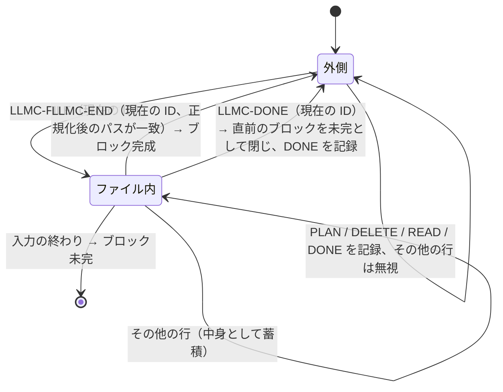
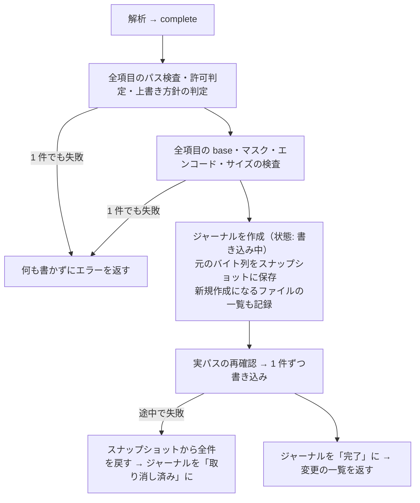

# ファイル入出力プロトコル仕様（llmc/1）

> **状態: 暫定版**。実物で確かめる仮説は plan.md 5.2 にまとめた。PoC の結果を受けて確定・修正する。

## 1. 目的と前提

- 画面操作では function calling を使えないため、**回答テキストの決まった書式**を解析して、ファイルの書き出し・削除・読み取り要求を扱う
- 回答は、コピーボタンが書き込む HTML から作った区分付きテキスト（Copilot での第一候補）、生の Markdown（そのままコピーされるサイト）、描画後の DOM から復元した区分付きテキスト（次善）のどれかとして届く（6.1）。**どれで届いても壊れない**ことを設計の条件とする
- 本書は書式（AI → llmc）、文脈の埋め込み（llmc → AI）、解析の規則、途中切れと省略の検出、パスの許可と正規化、文字コードと改行の扱い、書き込みの手順を定める
- 書式の説明文（AI に渡す規則）の原本と、その配布の仕方は spec-agent で定める
- 本書が守るのは **llmc 自身が書き込むファイル**である。ユーザー定義のコマンドで実行された AI のコードが行う書き込みは、本書の保護の範囲外であり、spec-security と spec-loop で扱う

## 2. 設計の要点

| 要件 | 解決方法 |
|---|---|
| Markdown として描画されても壊れない | すべてのメタ情報（パスなど）は**コードブロックの内側の行**に書く。info 文字列（言語名）は書かせない（Copilot のコピーの HTML で、言語名つきのブロックが描画された文章に崩れるため。4.3） |
| 入れ子のコードフェンスに耐える | ファイルの範囲は**フェンスではなく、内側の開始行と終了行**で決める。フェンスは描画を守るためだけに使い、長さを可変にする |
| 途中で切れたことを検出できる | ファイルごとの終了行と、回答全体の終了行を必須にする。どちらにもターンごとの ID を入れる |
| **提案全体が揃ったことを確かめられる** | 回答の冒頭で、出力するファイル・削除・読み取りの**一覧（計画）**を宣言させる。続きの依頼を含めて、計画と実際に揃ったものが一致したときだけ書き込む |
| 終了行の書き忘れで後続が飲み込まれない | ファイルの中で、現在の ID の開始行か終了行（回答全体）が現れたら、そこで直前のファイルを未完として打ち切る |
| **省略や記憶違いを検出できる** | 送った文脈ファイルにハッシュを付け、AI には書き換え元のハッシュを書き返させる。古い版を元にした書き換えは拒否する。「以下省略」などの省略の兆候を検出する |
| 自分のメッセージや古い回答を取り違えない | ID は送信ごとに変わる。プロンプトには ID を値としてだけ書き、指示行の完成形を書かない。文脈の埋め込みには回答と別の指示行を使う |
| 描画で閉じられた未完のブロックを書き込まない | ファイルの終了行が無いブロックは、フェンスが閉じていても未完とする |
| AI に数えさせない | 行数やファイル数の申告は求めない（LLM は正確に数えられない）。計画は「名前の一覧」なので数える必要が無い |

## 3. 用語

| 用語 | 意味 |
|---|---|
| ターン | llmc の送信 1 回と、それに対する回答 1 回 |
| ターン ID | ターンごとに llmc が発行する 6 文字の ID。英大文字と数字から、紛らわしい文字（`0 O 1 I L`）を除いた 31 文字で作る（例: `K7Q2MX`）。比較は大文字小文字を区別しない |
| 提案 | 1 つの依頼に対する、AI の変更の全体。続きの依頼で複数のターンに分かれることがある |
| 指示行 | `LLMC-` で始まる 1 行 |
| ファイルブロック | `LLMC-FILE` 行から、同じ ID とパスを持つ `LLMC-END` 行までの範囲 |
| ワークスペース | 書き込みと読み取りの基準になるディレクトリ。ループではループ定義の `workspace`、それ以外ではカレントディレクトリか `-o` の場所 |
| 内容ハッシュ | 文脈として送ったテキストの SHA-256 の先頭 8 文字（16 進数の小文字）。対象は**マスキング後、改行を LF にそろえた後、空行の代わりの行（9.6）に置き換える前**のテキスト |
| 空行の代わりの行 | 送るときに空行の代わりに入れる、空白だけの行（9.6）。ターンごとに決め、解析器に渡す |

## 4. 回答の書式（AI → llmc）

### 4.1 全体の例

`````
````
LLMC-PLAN id=K7Q2MX write="config/app.yaml"
LLMC-PLAN id=K7Q2MX delete="config/old.yaml"
````

````
LLMC-FILE id=K7Q2MX path="config/app.yaml" base=1a2b3c4d
server:
  workers: 8
  timeout: 30
LLMC-END id=K7Q2MX path="config/app.yaml"
````

````
LLMC-DELETE id=K7Q2MX path="config/old.yaml"
````

## 変更点
- workers を 4 から 8 に増やした

````
LLMC-DONE v=1 id=K7Q2MX rev=3fa9c1
````
`````

回答の順序は「計画 → ファイル・削除・読み取り → 自由な説明 → 終了行」とする。

### 4.2 指示行の一覧

| 指示行 | 書式 | 置く場所 |
|---|---|---|
| 計画 | `LLMC-PLAN id=<ID> write="<パス>"`、`delete="<パス>"`、`read="<パス>"` のいずれか 1 つ（1 行に 1 項目） | 回答の最初のコードブロック |
| ファイルの開始 | `LLMC-FILE id=<ID> path="<パス>" base=<内容ハッシュ>\|new` | コードブロックの内側の 1 行目（区分付きテキストでは、`code` 区分の最初の空でない行） |
| ファイルの終了 | `LLMC-END id=<ID> path="<パス>"` | 同じコードブロックの内側の最終行 |
| 削除 | `LLMC-DELETE id=<ID> path="<パス>"` | コードブロックの内側 |
| 読み取り要求 | `LLMC-READ id=<ID> path="<パス>" [head=<N>] [tail=<N>] [lines=<A>-<B>] [grep="<文字列>"]` | コードブロックの内側 |
| 回答の終了 | `LLMC-DONE v=<版> id=<ID> [rev=<規則の版>]` | 回答の最後の指示行。コードブロックの内側を推奨（外側でも受け付ける） |

- 属性の値の引用符は `"` と `'` のどちらでもよく、空白を含まない値は省略できる
- 属性の順序は自由。知らない属性は無視し、警告を記録する（前方互換のため）。v1 より前の案にあった `lines=` は受け付けるが、AI には求めない
- `base` は、文脈として送ったファイルを書き換える場合はそのファイルの `sha`（5 章）を、新しく作る場合は `new` を書く。`base=new` でも、書き込みの時点で対象がディスクにあれば `E_EXISTS_UNSEEN`（中身を見ていないファイルの上書きを防ぐ。全文を文脈として送り直して出し直しを依頼する）
- 変更する項目が無い場合（ループで「これ以上の改善案が無い」場合など）は、計画を書かずに終了行だけを書く

### 4.3 フェンスの規則（AI への依頼）

- ファイルブロックは**バッククォート 4 個以上**のフェンスで囲む。ファイルの中にバッククォートが 4 個以上連続する箇所があれば、それより長くする
- **info 文字列（言語名）は書かない**（開きの行はバッククォートだけにする）。PoC（S0b）で、Copilot の「応答のコピー」の HTML は、言語名つきのコードブロックを `<pre>` ではなく Markdown として描画した行の並び（`__init__` が太字になる）にすることが分かった。言語名なしなら、バッククォートの数（3〜5）やチルダによらず `<pre>` になる
- **`LLMC-FILE` を info 文字列に書いてはいけない**（`E_HEADER_IN_INFO`）
- チルダのフェンス（`~~~~`）も受け付けるが、AI にはバッククォートを求める

解析はファイルの範囲をフェンスで決めない（6 章）ので、生の Markdown で取れた場合は、AI がフェンスの長さを誤っても中身は正しく取れる。区分付きテキスト（コピーの HTML・DOM）の場合は、フェンスの誤りで描画が分断された箇所を検出して未完として扱う（6.5）。

### 4.4 ファイルの中身の範囲

- `LLMC-FILE` 行の次の行から、`LLMC-END` 行の前の行までが、ファイルの中身
- 中身の行の内容は一切変換しない（行頭の空白、タブ、行末の空白を保つ）。改行コードだけは解析の時点で LF にそろえる（9 章で元に合わせる）
- 中身が 0 行の場合は空のファイルとする
- 最終行の後の改行の有無は、回答からは判断できない。元のファイルに合わせる（9.4）

## 5. 文脈の埋め込み（llmc → AI）

llmc が送る文脈ファイルは、回答の書式と**別の指示行**で埋め込む。自分のメッセージを回答として取り違えた場合でも、回答の書式として解析されないようにするためである。

`````text
````
LLMC-CTX path="config/app.yaml" sha=1a2b3c4d lines=3 masked=1
server:
  workers: 4
  password: @@LLMC-MASK-0001@@
LLMC-CTX-END path="config/app.yaml"
````
`````

| 属性 | 意味 |
|---|---|
| `path` | ワークスペースからの相対パス |
| `sha` | 内容ハッシュ。AI が書き換えるときに `base` として書き返す |
| `lines` | 行数（llmc が数えるので正確） |
| `masked` | マスキングで置換した箇所の数（spec-security） |
| `range` | 一部だけ送る場合の範囲（`head=50`、`lines=100-180` など）。一部だけ送ったファイルは書き換えを許さない（`E_PARTIAL_BASE`） |
| `state` | 同じチャットを続ける場合の、前回からの変化（`new`、`changed`、`unchanged`）。`unchanged` の場合は中身を省略し、この行と `sha` だけを送る |

- フェンスの長さは llmc が計算する（中身の中で最も長いバッククォートの連続 + 1、最小 4）。言語名は付けない（AI が書き写すため。4.3）
- 読み取り要求への返答も同じ形式で返す。許可されなかった要求は `LLMC-CTX-DENIED path="..." reason="..."` で返す
- プロンプトには、プロトコルの版とターン ID を**値として**、冒頭と末尾（出力の直前）の両方に書く。指示行の完成形（`LLMC-DONE ... id=K7Q2MX` のような文字列）はプロンプトに書かない

```text
llmc プロトコル: llmc/1（規則の版 3fa9c1）
このターンの ID: K7Q2MX
```

### 5.1 省略した文脈と書き換えの関係

- `state=unchanged` で中身を省略したファイルを AI が書き換えた場合、AI は前のターンの記憶から全文を再現していることになる。`base` が最新の `sha` と一致していても、記憶違いの危険は残る
- そのため、ループ定義の `context.resend_before_edit`（既定 `true`）が有効なら、`unchanged` で送ったファイルへの書き換えは**そのターンでは採用せず**、全文を送り直して出し直しを依頼する（`E_STALE_CONTEXT`）。利用量は 1 ターン増えるが、記憶違いによる気付かない変更を防ぐ
- `false` にした場合は採用し、6.6 の省略の検出だけを行う

## 6. 解析の規則

### 6.1 入力

解析器は、ドライバから次のどちらかを受け取る（spec-browser-driver）。

| 入力 | 内容 | 位置づけ |
|---|---|---|
| 区分付きテキスト（コピーの HTML） | コピーボタンが書き込む `text/html` から作った、`text` と `code`（`<pre>` 1 つにつき 1 区分）の区分の列 | 第一候補（Copilot） |
| 区分付きテキスト（DOM） | DOM から復元した、同じ形の区分の列 | 次善 |
| 生テキスト | コピーボタンが書き込む Markdown（`text/plain`） | Markdown のままコピーされるサイト |

- PoC の実測で、Copilot（個人版・組織版）のコピーの `text/plain` は Markdown ではなく、**コードブロックのフェンスの行が消えた**テキストだった。これではコードブロックの内と外を区別できず、6.3 の「コードブロックの中だけを採用する」規則を守れないため、Copilot では `text/html` を使う
- `text/html` が無く、フェンスの無いテキストしか無い場合は、`LLMC-FILE`・`LLMC-DELETE`・`LLMC-READ` を**採用しない**（`E_RENDERED_DIRECTIVE`）。説明文の `__init__` が `init` に変わるのと同じく、コードブロックの外に書かれた開始行のパスが描画で変わり、別のファイルに書き込む恐れがあるため。PoC の解析器にあった `W_PLAIN_COPY`（警告で受け付ける扱い）は本実装では作らない

### 6.2 指示行の判定

1. 改行を LF にそろえる
2. ファイルの外側の行は、判定の前に次を取り除く: 前後の空白、BOM とゼロ幅文字（U+200B〜U+200D、U+FEFF）、前後を囲むバッククォートと `*`、行頭の引用符（`>`）と箇条書きの記号（`- `、`* `）。AI が終了行をインラインコードや太字で囲む癖への対処である
3. ファイルの内側の行は、前後の空白とゼロ幅文字だけを取り除いて判定する（中身の行を誤って指示行とみなさないため）
4. 正規表現 `^LLMC-(PLAN|FILE|END|DELETE|READ|DONE)\b(.*)$` で判定する。`LLMC-CTX` で始まる行は文脈の埋め込みであり、回答の指示行としては扱わない（見つかった場合は警告 `W_ECHOED_CONTEXT`）
5. フェンスの開始行の info 文字列に `LLMC-FILE` があれば `E_HEADER_IN_INFO`

### 6.3 状態機械



- ファイルの中では、**現在の ID を持つ** `LLMC-END`・`LLMC-FILE`・`LLMC-DONE` 以外の行はすべて中身として扱う。ID はターンごとの乱数なので、正当な中身（llmc 自身の説明書など）と衝突しない
- `LLMC-END` のパスは、8.1 の正規化を行った比較用の値で比べる（`\` と `/`、大文字小文字の違いを許す）
- ID かパスが一致しない `LLMC-END` は中身として扱い、警告 `W_FOREIGN_END` を記録する
- ID が一致しない `LLMC-FILE`・`LLMC-PLAN` などは無視し、`E_ID_MISMATCH` を記録する（古い ID の使い回しや、例の書き写し）
- `LLMC-DELETE`・`LLMC-READ`・`LLMC-FILE` は、**コードブロックの中にあるものだけ**を採用する（抽出方式によらず同じ規則）。外側にあるものは `E_RENDERED_DIRECTIVE`（描画でパスが壊れ、別のファイルを消したり書いたりする恐れがあるため）。
- `LLMC-PLAN` は、コードブロックの外にあっても警告（`W_PLAN_IN_TEXT`）として受け付ける（PoC で、組織版の AI が計画だけを文章として書くことがあった）。計画は提案の完全性の確認にしか使わないので、パスが描画で壊れても計画の不一致（`E_PLAN_MISMATCH`）で提案全体が拒否されるだけで、誤った場所への書き込みは起きない。生テキストでは、ファイルの外側の範囲でフェンスの開閉を追跡して判定する
- 削除の行を `LLMC-FILE`〜`LLMC-END` で囲んだ形（PoC で個人版の AI が書いた）は、次をすべて満たすときに限り削除として受け付ける（`W_DELETE_IN_FILE`）。満たさなければファイルの中身として扱う
  - ブロックの中身が、空行を除いて `LLMC-DELETE` の 1 行だけ
  - その行を通常の指示行の解析（属性の順序は自由、引用符は `"` か `'`）で読み、ID が現在の ID で、パスがブロックのパスと正規化後に一致する
  - 計画でそのパスを削除するとしている
- `LLMC-DONE` は回答に 1 つだけで、最後の指示行でなければならない。2 つ以上は `E_MULTIPLE_DONE`、後ろに指示行があれば `E_AFTER_DONE`

### 6.4 ターンの判定

| 優先 | 分類 | 条件 | 呼び出し元の対応 |
|---|---|---|---|
| 1 | `no_protocol` | 指示行が 1 つも無い | 用途による（ループでは形式違反） |
| 2 | `invalid` | `E_ID_MISMATCH`、`E_HEADER_IN_INFO`、`E_MULTIPLE_DONE`、`E_AFTER_DONE`、`E_RENDERED_DIRECTIVE` のどれかがある | 提案全体の出し直しを依頼 |
| 3 | `truncated` | `LLMC-DONE` が無い、または未完のファイルブロックがある | 続きの依頼（6.7） |
| 4 | `invalid` | 計画の不一致（`E_NO_PLAN`、`E_PLAN_MISMATCH`）、パス・エンコード・サイズ・ハッシュのエラーなど 6.8 のエラーがある | エラーの内容を添えて出し直しを依頼 |
| 5 | `empty` | `LLMC-DONE` だけで、計画も操作も無い | 用途による（ループでは「改善案なし」） |
| 6 | `complete` | 上のどれにも当たらない | 書き込み |

- 計画の一致: 計画の項目の集合と、「完成したファイルブロック・削除・読み取り要求」の集合が、正規化後のパスで一致すること。操作があるのに計画が無ければ `E_NO_PLAN`
- 判定の結果には、すべてのエラーと警告の一覧を付ける（再依頼の文面と記録に使う）

### 6.5 区分付きテキスト（コピーの HTML・DOM）の追加の規則

- ファイルブロックの開始行と終了行が、**同じ `code` 区分の中**にあること。別々の区分にまたがる場合（AI のフェンスの長さの誤りで描画が分断された）は `E_SPLIT_BLOCK` として未完扱いにする
- 指示行がコードブロックの中にあるかどうかは、区分の種類で判定する
- `LLMC-DONE` は `text` 区分にあっても採用する（パスを含まず、記号も `=` だけなので描画で壊れない）
- コピーの HTML（`CF_HTML`）の読み方
  - バイト列を **UTF-8 として厳密に復号**する。復号できなければ抽出の失敗とする（壊れた文字を置き換えて続けない）
  - 断片の位置は、ヘッダの `StartFragment`・`EndFragment`（バイト位置）を優先し、`<!--StartFragment-->` のコメントは代わりの手段とする
  - ヘッダの `SourceURL` が、期待するサイトの URL であることを確かめる（人が送信する方式で、他のページからのコピーを取り違えないため）
- 区分を作る規則
  - `<pre>` の中を `code` 区分とし、改行と空白をそのまま保つ。実体参照の `&nbsp;` だけを空白に戻し、文字として書かれた U+00A0 は残す（元のファイルの U+00A0 を変えないため。Copilot が実体参照で出すかは PoC-6 で確かめる）
  - `<pre>` の中で許す要素は `code`・`span`・`br` だけとする。それ以外（`strong`・`em`・`a`・`img` など）があれば、その区分は描画で中身が変わった恐れがあるので使わない（`E_RENDERED_CODE`）。`<pre>` の入れ子や、閉じていない `<pre>` も同じ扱い
  - `<p>`・`<div>`・`<li>`・見出しなどのブロック要素の境目は `text` 区分の改行とする。`<style>`・`<head>` の中は捨てる
  - 回答に `` があれば（PoC で、言語名つきの大きなブロックが画像になった）、抽出の失敗として扱う（`E_EXTRACT_IMAGE`）
- 言語名つきのコードブロックが崩れた形を、構造で見分ける: **`<pre>` の外で、ブロック要素（`div` の中の `span`）1 つが 1 行になった並びが続き、そのどれかの行が `LLMC-` で始まる**。見つけたら `W_LANG_FENCE` を記録し、再依頼の文面で「フェンスに言語名を書かない」ことを求める（指示行はコードブロックの外にあることになるので、提案は `E_RENDERED_DIRECTIVE` で拒否される）

### 6.6 省略の検出

全文置換では、AI が中身の一部を省略する（「以下変更なし」など）ことがある。完成したファイルブロックごとに次を調べる。

| 兆候 | 例 |
|---|---|
| 省略を示す定型の行 | `...`、`…` だけの行。コメントの中の「省略」「以下同じ」「変更なし」「(rest of file)」「unchanged」「existing code」など（一覧は規則の原本に持つ） |
| 大きな縮小 | `base` の元のファイルより、行数が 50% 以上減った |

- **`...`・`…` だけの行は、既定でエラー**（`E_ELIDED`）とし、書き込まない。PoC-6 で、出力の上限を超える長さのファイルを頼むと、AI が途中を `...` の 1 行にして `LLMC-END`・`LLMC-DONE` まで書き、`complete` の形になった（書式の上では完全なので、警告だけでは壊れたファイルを書き込んでしまう）。元のファイルに `...` だけの行がある場合は、その行数を超えたときだけエラーにする
- コメントの中の定型の語句（「省略」「以下同じ」など）は、既定では警告 `W_SUSPECT_ELISION` として記録し、ループでは確認を求めずに書き込む。ループ定義の `elision: reject` で、**拒否して出し直しを依頼**する扱いにできる（設定ファイルの最適化では `reject` を推奨する）
- 意図して大きく縮める場合もあるので、縮小だけで拒否はしない（`reject` の場合も、定型の行が無く縮小だけなら警告にとどめる）
- `E_ELIDED` が出たときに、ファイルが 1 回の回答の出力の上限（11 章）を超えていそうなら、同じ依頼を繰り返しても直らない。再依頼ではなく、分割の出力（11.1）を使う

### 6.7 続きの依頼

- `truncated` の場合、完成したファイルブロック・削除・読み取り要求は、その提案の「保留」として持つ
- 続きの依頼では、**計画のうち、まだ完成していない項目をすべて**パスの一覧で示し、それだけを出し直すよう依頼する。計画行が途中で切れて計画そのものが分からない場合は、提案全体の出し直しを依頼する
- 続きの依頼には、未完成の項目のうち文脈として送ったファイルの**全文を送り直す**（PoC-7: 同じチャットでも、AI は前のターンのファイルの中身を持っていないとして、推測を避けて断った）
- 続きの回答も同じ書式（計画・ファイル・終了行）で、新しいターン ID を使う。続きの回答の計画は、元の計画の残りの部分と一致しなければならない。元の計画に無い項目があれば `E_PLAN_CHANGED`（提案全体の出し直し）
- 続きの回答で、保留のものと同じパスが再び出力された場合は、新しい方を採用する
- 元の計画の全項目が揃ったときに、提案全体を `complete` とみなし、保留のものを含めて一度に書き込む
- 続きの依頼の上限（既定 2 回）に達しても揃わない場合は、**何も書き込まず**、形式違反として扱う

### 6.8 エラーと警告

エラーがある提案は、**1 件も書き込まない**（全件書き込むか、まったく書かないか）。

| コード | 意味 | 再依頼の文面（要旨） |
|---|---|---|
| `E_NO_DONE` | 終了行が無い（途中切れ） | 未完成の項目の一覧を示して続きを依頼 |
| `E_UNTERMINATED` | ファイルの終了行が無い | 同上 |
| `E_SPLIT_BLOCK` | ブロックが描画で分断された | フェンスをもっと長くして出し直しを依頼 |
| `E_ID_MISMATCH` | ID が違う（古い ID、`<ID>` のような書き写し） | 正しい ID を示して提案全体の出し直しを依頼 |
| `E_HEADER_IN_INFO` | `LLMC-FILE` をフェンスの info 文字列に書いた | 開始行はブロックの内側の 1 行目に書くよう依頼 |
| `E_MULTIPLE_DONE` / `E_AFTER_DONE` | 終了行が複数ある、または終了行の後に指示行がある | 終了行は最後に 1 つだけ書くよう依頼 |
| `E_RENDERED_DIRECTIVE` | ファイルの開始・削除・読み取りの指示行がコードブロックの外にある | コードブロックの中に書くよう依頼（`W_LANG_FENCE` があれば、言語名を書かないよう依頼） |
| `E_RENDERED_CODE` | コピーの HTML の `<pre>` の中に、描画された要素（`strong` など）がある（6.5） | 出し直しを依頼。続くなら画面の変更として報告 |
| `E_EXTRACT_IMAGE` | 回答のコピーの HTML に画像がある（6.5） | 言語名を書かないよう依頼して出し直し |
| `E_EXISTS_UNSEEN` | `base=new` だが、対象がディスクにある（4.2） | 全文を文脈として送り直す |
| `E_NO_PLAN` | 操作があるのに計画が無い | 計画を最初に書くよう依頼 |
| `E_PLAN_MISMATCH` | 計画と、実際に揃った項目が違う | 計画と実際の差を示す |
| `E_PLAN_CHANGED` | 続きの回答の計画が、元の計画の残りと違う | 提案全体の出し直しを依頼 |
| `E_DUPLICATE_PATH` | 同じパスの項目が 2 つ以上ある（正規化後に比較） | 1 つにまとめるよう依頼 |
| `E_PATH_INVALID` | パスの書き方が不正（8.2） | 理由を示す |
| `E_PATH_DENIED` | 許可リストに無い | 許可されているパスの一覧を示す |
| `E_PROTECTED` | 変更禁止のパス | 変更禁止であることを示す |
| `E_BINARY_TARGET` | バイナリのファイルに書こうとした | テキストでは書けないことを示す |
| `E_ENCODING` | 書き込む文字コードで表せない文字がある | 該当する文字と行を示す |
| `E_TOO_LARGE` | 1 ファイル・1 提案のサイズ上限を超えた | 上限を示す |
| `E_STALE_BASE` | `base` が最新の `sha` と違う、または `base` が無い（既存ファイルの書き換え） | 最新の全文を送り直す |
| `E_STALE_CONTEXT` | 中身を省略して送ったファイルを書き換えた（5.1） | 全文を送り直す |
| `E_PARTIAL_BASE` | 一部だけ送ったファイルを書き換えた | 全文を送るか、書き換えないよう依頼 |
| `E_EXISTS` | 呼び出し元が上書きを禁止している既存のファイルに書こうとした（UC5） | — （利用者に通知） |
| `E_TOOL_ARTIFACT` | テキストではなく、ツールで作ったファイル（ダウンロードのリンク）が返った（ループでのみ） | テキストで出力するよう依頼（spec-agent 5.1） |
| `E_MASK_MOVED` | マスクの置換文字列が、そのマスクを作ったファイル以外にある（9.5） | 置換文字列を他のファイルに書かないよう依頼 |
| `E_UNKNOWN_MASK` | 存在しないマスクの置換文字列がある | — |
| `E_ELIDED` | ファイルの中に `...`・`…` だけの行がある（6.6） | 省略せずに出すよう依頼。出力の上限を超えていそうなら分割の出力（11.1） |
| `W_SUSPECT_ELISION` | 省略の兆候がある（6.6。`elision: reject` ならエラー扱い） | — |
| `W_VERSION_MISMATCH` | `v` が違う、または無い | — （解析できれば続行） |
| `W_REV_MISMATCH` | `rev` が期待と違う | — （spec-agent 2.2） |
| `W_MIXED_READ_WRITE` | 読み取り要求と書き込みが同じ提案にある | 7.3 |
| `W_ECHOED_CONTEXT` | 回答に `LLMC-CTX` 行がある | — |
| `W_FOREIGN_END` | ファイル内に、ID かパスが違う終了行がある | — |
| `W_MIXED_NEWLINE` | 元のファイルの改行が混在している | — |
| `W_PLAN_IN_TEXT` | 計画の行がコードブロックの外にある（6.3） | — |
| `W_DELETE_IN_FILE` | 削除の行をファイルブロックで囲んだ（6.3） | — （次のターンの規則で注意する） |
| `W_LANG_FENCE` | 言語名つきのフェンスで、コピーの HTML が崩れた（6.5） | フェンスに言語名を書かないよう依頼 |
| `W_SPACE_LINE_RESTORED` | 空行の代わりの行を空行に戻した（9.6） | — |
| `W_BR_RESTORED` | `<br>` だけの行を空行に戻した（空行をそのまま送ったターンだけ。9.6） | — |
| `W_BR_LINE` | 空行の代わりの行を使ったターンで、`<br>` だけの行がある（書き換えない） | — |
| `W_BASE_FOR_NEW` | 文脈として送っていないファイルに、`new` 以外の `base` が書かれた | — |
| `W_DIRECTIVE_IN_CONTENT` | ファイルの中身に `LLMC-` で始まる行がある（中身として扱った） | — |
| `W_STRAY_END` | ファイルの外に、対応する開始行の無い終了行がある | — |

## 7. 読み取り要求

### 7.1 書式

```text
LLMC-READ id=K7Q2MX path="logs/app.log" tail=200
LLMC-READ id=K7Q2MX path="logs/app.log" grep="ERROR" tail=50
```

- `head`、`tail`、`lines` は 1 つまで指定できる。何も指定しない場合は全体（サイズ上限まで）
- `grep` は**正規表現ではなく、部分一致の文字列**（大文字小文字を区別しない）とする。AI が書いた正規表現を Python の `re` で実行すると、時間の上限を設けられず処理が止まる恐れがある（ReDoS）ため
- 1 ターンあたりの要求数と、返す内容の合計サイズに上限を設ける（ループ定義で指定。既定 5 件・20,000 文字）

### 7.2 許可と確認

| モード | 動作 |
|---|---|
| 対話（UC1） | 許可リストに合うものを一覧で示し、利用者が確認してから返す。合わないものは確認もせずに拒否する |
| ループ（UC3） | ループ定義で事前に許可した範囲だけを自動で返す。それ以外は `LLMC-CTX-DENIED` で返す |
| 非対話（UC2、UC5） | ループと同じ（事前に許可した範囲だけ）。許可が無ければすべて拒否する |

返す内容には、送信前のマスキングを必ず適用する。読み取りにも 8.4 の実パスの確認を行う。

### 7.3 読み取りと書き込みが同じ提案にある場合

読み取り要求を先に処理して内容を返し、その提案の書き込みと削除は**行わない**。返答で「読み取った内容を踏まえて、改めて提案全体を出力してください」と依頼する。提案が読み取りの結果に依存している可能性が高いので、先に書かせないためである。

## 8. パスの許可と正規化

### 8.1 正規化の手順

AI が書いたパスと、ループ定義に書かれたパターンの両方に同じ手順を適用する。

1. Unicode の NFC 正規化
2. `\` を `/` に置き換える
3. 先頭の `./` を取り除き、連続する `/` を 1 つにする
4. 文字列としての検査（8.2）
5. 構成要素ごとに比較用の値を作る。**1 文字ずつの単純な大文字化**で、長さが変わる変換（`ß` → `SS` など）はしない。NTFS の大文字小文字を区別しない比較に近づけるためであり、`str.casefold()` は使わない
6. 許可リストと変更禁止リストを、比較用の値で照合する（8.3）
7. ワークスペースの実パスと結合し、実パスの確認を行う（8.4）

既存のファイルに書く場合は、AI が書いた表記ではなく、**ディスク上の実際の名前**（大文字小文字を含む）で書き込む。

### 8.2 文字列として拒否するもの（`E_PATH_INVALID`）

| 拒否するもの | 例 | 理由 |
|---|---|---|
| 空のパス、`/` で終わるパス | `""`、`src/` | ファイルを指さない |
| 絶対パス、ドライブ指定、UNC | `C:\x`、`C:x`、`/x`、`\\srv\x`、`\\?\C:\x` | ワークスペースの外 |
| `..` の構成要素 | `src/../tests/x` | 正規化で解決すれば許可判定はできるが、正当な用途が無いので一律に拒否する（参考実装 #2 の抜け道を構造的にふさぐ） |
| `:` を含む | `a.py:hidden`、`a.py::$DATA` | 代替データストリーム、ドライブ相対 |
| 制御文字、`< > " \| ? *` | — | Windows で使えない |
| 末尾がドットか空白の構成要素 | `tests./x`、`tests /x` | Win32 API が切り詰め、別のパスに書かれる |
| 予約デバイス名（拡張子付きも含む、大文字小文字を問わない） | `CON`、`nul.txt`、`COM1`、`LPT9`、`COM¹`、`CONIN$`、`CONOUT$`、`CLOCK$` | デバイスへの書き込みになる |
| 8.3 形式の短い名前に見える構成要素 | `TESTS~1` | 長い名前の変更禁止を回避できる。`~` の後に数字が続くものを拒否 |
| 構成要素 1 つが 255 文字超、**ワークスペースと結合した絶対パス**が 240 文字超 | — | MAX_PATH の問題を避ける |

### 8.3 許可リストと変更禁止リスト

#### パターンの文法

gitignore とは違い、**すべてのパターンはワークスペースの直下を基準に固定する**。`/` を含まないパターンが任意の深さに一致することはない（許可リストで意図より広く許さないため）。

| パターン | 一致するもの | 一致しないもの |
|---|---|---|
| `config/app.yaml` | `config/app.yaml` | `sub/config/app.yaml` |
| `*.yaml` | `a.yaml` | `config/a.yaml` |
| `config/*.yaml` | `config/a.yaml` | `config/x/a.yaml` |
| `config/**/*.yaml` | `config/a.yaml`、`config/x/y/a.yaml` | `a.yaml` |
| `**/conftest.py` | `conftest.py`、`tests/conftest.py` | — |
| `tests/` | `tests/` 以下のすべて | `tests`（同名のファイル） |

- `*` は `/` をまたがない。`**` は 0 個以上のディレクトリにまたがる。末尾の `/` はディレクトリ以下全体
- 判定の優先順位: **常時禁止 > 変更禁止 > 許可**。どれにも当たらなければ拒否（許可リスト方式）
- 読み取りも同じ仕組みで、読み取り許可リストを使う。変更禁止のファイルは、読み取りは許可できる（評価スクリプトを AI に見せる、などの用途）

#### 常時禁止（読み書きとも。ループ定義で解除できない）

| パターン | 理由 |
|---|---|
| `**/.git/`、`**/.hg/`、`**/.svn/`、および `.git` という名前のファイル | リポジトリの管理領域 |
| ループ定義ファイル自身、レシピファイル、run ディレクトリ | 評価条件の書き換えを防ぐ |
| `%LOCALAPPDATA%\llmc\` 以下（ワークスペースに含まれる場合） | ブラウザのプロファイル、デーモンの認証キー、記録 |
| llmc の設定・サイト別プロファイル（ワークスペースに置かれている場合） | 次回の動作の書き換えを防ぐ |
| `**/*.lnk`、`**/*.url`、`**/desktop.ini`（書き込みのみ） | ショートカット経由の実行 |

#### 既定で読み取りを禁止するもの（ループ定義で明示的に許可すれば読める）

`**/.env`、`**/.env.*`、`**/*.pem`、`**/*.key`、`**/*.pfx`、`**/*.p12`、`**/id_rsa*`、`**/id_ed25519*`、`**/*.kdbx`、`**/.npmrc`、`**/.pypirc`、`**/.netrc`、`**/.git-credentials`

#### 書き込みを許可すると警告するもの

実行コマンドの動作を変えられるファイルを AI が書けると、「コマンドは利用者が決める」（FR-UC3-04）を実質的にすり抜けられる。次に当たるパターンが書き込み許可に入っていれば、ループ定義の検証で警告する。

- 一般的な規則: **実行コマンドが読み込む設定ファイル**（ループ定義の `run.reads_config` で列挙。spec-loop）
- 既定の一覧: `.vscode/`、`.idea/`、`.github/`、`**/conftest.py`、`**/pytest.ini`、`**/tox.ini`、`**/setup.cfg`、`**/pyproject.toml`、`**/sitecustomize.py`、`**/usercustomize.py`、`**/*.pth`、`**/package.json`、`**/Makefile`、`**/Directory.Build.props`、`**/*.csproj`、`**/*.bat`、`**/*.cmd`、`**/*.ps1`、`**/*.exe`、`**/*.dll`

理由と残るリスクは spec-security に書く。

### 8.4 実パスの確認

- ワークスペースの実パス（`GetFinalPathNameByHandle` で得た正式な表記）を基準にする
- 対象の親ディレクトリを、ワークスペースから順にたどる。途中か対象そのものに、**名前を差し替えるリパースポイント**があれば拒否する（ループ定義で明示的に許可した場合を除く）
  - 拒否するもの: リパースタグに名前の差し替えを示すビット（`0x20000000`）が立っているもの（シンボリックリンク、ジャンクション、WSL のリンクなど）、`IO_REPARSE_TAG_AF_UNIX`、`IO_REPARSE_TAG_APPEXECLINK`
  - 許可するもの: OneDrive のファイル オンデマンド（`IO_REPARSE_TAG_CLOUD_*`）、重複除去（`DEDUP`）、圧縮（`WOF`）など、名前を差し替えないもの。社内 PC ではドキュメントやデスクトップが OneDrive の配下にあることが多いため
  - タグは `os.lstat()` の `st_reparse_tag` で得る
- **読み取りにも同じ確認を行う**（ジャンクション経由でワークスペースの外を読ませないため）
- 確認は解析の直後と、**書き込み・読み取りの直前の 2 回**行う（確認と操作の間の差し替えを狭める）
- 既存のファイルに読み取り専用属性がある場合は拒否する（属性を外して書くことはしない）

## 9. 文字コードと改行

### 9.1 既存ファイルの判定

| 順序 | 判定 | 結果 |
|---|---|---|
| 1 | ループ定義の `encoding` の指定（パターンごと） | 指定のとおり |
| 2 | BOM（UTF-8、UTF-16 LE/BE） | BOM のとおり。UTF-16 は v1 では読み取りのみ対応し、書き込みは `E_ENCODING` |
| 3 | NUL バイトを含む、または拡張子がバイナリの一覧にある | **バイナリ**（テキストとして送らず、書き込まない） |
| 4 | ASCII だけ | **ASCII**（9.4 の 4 で書き込む文字コードを決める） |
| 5 | UTF-8 として厳密に復号できる | UTF-8（BOM なし） |
| 6 | cp932 として厳密に復号できる | Shift_JIS（cp932） |
| 7 | どれにも当たらない | 未対応（送らず、書き込まない） |

統計的な推定（charset-normalizer など）は使わない。判定の結果が毎回同じになるよう、決まった順序で判定する。

### 9.2 改行の判定

| ファイルの状態 | 判定 |
|---|---|
| CRLF だけ | CRLF |
| LF だけ | LF |
| 混在 | 多い方。警告 `W_MIXED_NEWLINE` |
| 改行が無い（1 行だけ） | 新規ファイルの規則（9.3）に従う |

### 9.3 新規ファイル

ループ定義の `new_file_defaults` で、パターンごとに文字コード・BOM・改行・最終行の改行を指定できる。指定が無い場合の既定値:

| パターン | 文字コード | 改行 | 理由 |
|---|---|---|---|
| `**/*.ps1`、`**/*.psm1`、`**/*.psd1` | UTF-8（BOM 付き） | CRLF | PowerShell 5.1 は BOM の無いスクリプトを ANSI（cp932）として読むため |
| `**/*.bat`、`**/*.cmd` | cp932 | CRLF | cmd.exe はコードページで読むため |
| その他 | UTF-8（BOM なし） | LF | — |

### 9.4 書き込み

1. 中身（LF でそろえたもの）を、元のファイルの改行コードに変換する
2. 最終行の後の改行は、元のファイルにあれば付け、無ければ付けない。新規ファイルは既定で付ける
3. マスクの置換文字列を元の値に戻す（9.5）
4. 書き込む文字コードを決める
   - 元が UTF-8・BOM 付き UTF-8・cp932: 元のとおり
   - 元が ASCII: 新しい中身も ASCII だけなら ASCII のまま。ASCII 以外の文字が入る場合は、**9.3 の拡張子ごとの既定**（`.ps1` は BOM 付き UTF-8、`.bat` は cp932、その他は UTF-8）を使う。ASCII だけの `.ps1` に日本語を書くと、PowerShell 5.1 が cp932 として読んで文字化けするため
5. エンコードする。表せない文字があれば `E_ENCODING`
6. 中身が元のファイルとバイト単位で同じなら書き込まない（「変更なし」として記録する）
7. 書き込みの方法（10 章）
8. Python の `write_text` などテキストモードの書き込みは使わない（改行が変わるため）。すべてバイト列で扱う

### 9.5 マスクの復元

- マスクの置換文字列（`@@LLMC-MASK-0001@@` など。形式は spec-security）は、**そのマスクを作ったファイルの中でだけ**元の値に戻す
- 他のファイルに置換文字列があれば `E_MASK_MOVED` として提案全体を拒否する。AI に秘密の値を別のファイル（実行されるスクリプト、出力される設定など）へ移させ、実行結果としてチャットに戻させる経路をふさぐため
- 戻すときに、置換文字列が元と同じキーの位置にあるか（YAML のキーなど）まで確かめるかは spec-security で決める
- 実行結果・ログ・読み取りの返答にも送信前のマスキングを必ずかける（spec-loop、spec-security）。ただし、AI が base64 などで値を変形して出力させる経路は防げない。この残るリスクは spec-security に書く

### 9.6 送信時

- 文脈ファイルは判定した文字コードで復号して送る。文字コードは AI に知らせない（AI は常に Unicode のテキストとして扱えばよい）
- バイナリと未対応のファイルは送らず、`LLMC-CTX-DENIED path="..." reason="binary"` を送る
- **空行の扱い**（PoC の S0）: Copilot の入力欄にテキストを貼り付けると、空行が `<br>` という文字列になって AI に届く。そこで、送る文面の空行を**空行の代わりの行**にしてから入力する（サイトのプロファイルの `input.blank_lines: filler`）
  - 代わりの行は、ターンごとにプロンプト組み立てが決める。空白 1 個、2 個、3 個……のうち、**そのターンで送るどの文脈ファイルにも、その行そのものとして現れない最短のもの**を選ぶ（ふつうは空白 1 個）
  - 選んだ行は `OutboundMessage.blank_line_filler` としてドライバに渡し、解析器にも渡す
  - 解析器は、回答のファイルの中身のうち、代わりの行と**完全に一致する行だけ**を空行に戻す（`W_SPACE_LINE_RESTORED`）。それ以外の空白だけの行（元のファイルにあったもの）は変えない。`base=new` のファイルにも同じ規則を当てる
  - AI が代わりの行をそのまま書き返すこと（空白 2 個の行を 1 個に縮めないか）は PoC-6 で確かめる。縮める場合は、代わりの行を使えない文脈ファイルを含むターンで `paste_html` 相当の別の方式を検討する
- テキストに加えて HTML（`<pre>`）でも入力する方式は空行を一字一句届けられるが、AI にフェンスが見えなくなり、書式の守り方が崩れた（PoC）。既定にはしない
- `<br>` だけの行の扱いは、空行をそのまま送ったターン（`blank_lines: raw`）とそれ以外で分ける
  - `raw` のターン: AI が `<br>` を書き写した恐れがあるので空行に戻す（`W_BR_RESTORED`）。元のファイルに `<br>` だけの行がある場合は戻さない
  - 代わりの行を使ったターン: 書き換えない（正当な Markdown・HTML の `<br>` を壊さないため）。警告 `W_BR_LINE` だけを記録する

## 10. 書き込みの手順



### 10.1 上書きの方針

書き込みの関数は、呼び出し元から上書きの方針を受け取る。

| 方針 | 動作 | 使う場面 |
|---|---|---|
| `allow` | 許可リストの範囲で上書きしてよい | ループ（UC3） |
| `confirm` | 既存のファイルへの書き込みは、差分を示して確認する | 対話（UC1） |
| `deny_existing` | 既存のファイルがあれば `E_EXISTS` | 変換（UC5）の既定。`--force` で `allow` |

### 10.2 1 件の書き込み

| 対象 | 方法 |
|---|---|
| 新規ファイル | 同じディレクトリの一時ファイルに書き、`os.replace` で名前を付ける |
| 既存ファイル | 同じディレクトリの一時ファイルに書き、`ReplaceFileW` で置き換える。元のファイルの ACL、属性、作成日時、代替データストリームを保つため（`os.replace` ではこれらが失われる） |
| 既存ファイルにハードリンクがある（リンク数が 2 以上） | 置き換えるとリンクが切れるので、警告を出したうえで元のファイルを開いて上書きする（スナップショットとジャーナルで戻せる） |
| 削除 | スナップショットに保存してから削除する |

- エディタやウイルス対策ソフトが開いていて `PermissionError` などになった場合は、間隔を広げながら最大 5 回（合計 3 秒程度）再試行する。それでも失敗すれば、その提案全体を戻す

### 10.3 ジャーナルと異常終了からの回復

- 書き込みの前に、ジャーナル（操作の一覧、スナップショットの場所、状態）を run ディレクトリ（ループ以外は `%LOCALAPPDATA%\llmc\journal\`）に書く
- llmc が書き込みの途中で強制終了した場合、次に同じワークスペースで llmc を起動したとき（`llmc loop resume`、`llmc undo` を含むすべての書き込みを伴うコマンドの開始時）に「書き込み中」のジャーナルを見つけ、スナップショットから元に戻してから処理を続ける。戻したことを stderr に表示する
- スナップショットの形式と保存場所は spec-loop（run ディレクトリ）で定める。ループ以外（UC1 の確認付き書き出し）でも同じ仕組みを使い、`llmc undo` で直前の書き出しを戻せる

## 11. 上限（既定値。ループ定義・設定で変更できる）

| 項目 | 既定値 | 備考 |
|---|---|---|
| 1 回の回答の出力 | 約 8,000 文字（個人版の実測。組織版は未確認） | PoC-6: 8,900 文字の回答（300 行のファイル）は全部出た。27,000 文字のファイルを頼むと、回答は 7,600 文字で、途中を `...` にした。AI 自身も「出力の上限のため省略せずに提示できない」と書いた。**1 ファイルの中身と 1 提案の合計は、この値に収める**（11.1） |
| 1 ファイルの中身 | 7,000 文字 | 1 回の回答の出力から、指示行と説明の分を引いた値。超えるファイルは分割の出力（11.1）を使う |
| 1 提案の合計 | 7,000 文字（1 回の回答の中） | 続きの依頼で複数の回答に分けられる（6.7） |
| 1 提案のファイル数 | 10 | — |
| 続きの依頼の回数 | 2 | — |
| 読み取り要求 | 1 ターン 5 件、合計 20,000 文字 | — |
| 1 回の送信の文字数 | 60,000 文字（個人版） | PoC-6: 64,000 文字まで送れ、最後の行の合言葉を正しく答えた（8,000・16,000・32,000・64,000 文字のすべて）。それ以上と組織版は未確認。サイト別プロファイルの `max_chars` に書く。プロンプト組み立ての予算に使う |

入力は大きく、出力は小さい（約 8 倍の差）。そのため、文脈は全文を送れても、書き返せるファイルの大きさは出力の上限で決まる。

### 11.1 1 回の回答に収まらないファイル（v1 は拒否。決定済み）

出力の上限（約 8,000 文字）を超えるファイルを書き換える方法は、次のどれかにする。

| 案 | 内容 | 長所 | 短所 |
|---|---|---|---|
| A. 分割の出力 | 1 つのファイルを、複数の回答に分けて出させる。各回答は `LLMC-FILE ... part=<n>` で始まり、最後の部分だけ `LLMC-END` で終わる。全部の部分が揃ったら連結して書き込む。**続きの依頼には、残りの範囲の元の中身を毎回送る**（開始行は llmc が数える） | 全文置換のまま（12 章の判断を変えない） | ターン数（利用量）が増える。部分の境目で行の重複・欠落が起き得る |
| B. 範囲の置き換え | 行番号の範囲を指定して、その範囲だけを書き換えさせる（`LLMC-EDIT path=... lines=120-180`）。llmc が送るファイルには行番号を付ける | 出力が小さい | 差分形式に近く、12 章の判断を見直すことになる。AI が行番号を誤る |
| C. 上限を超えるファイルは書き換えない | 計画の段階で拒否し、利用者に知らせる | 単純 | UC5（変換）で大きな出力ができない |

- PoC-7（個人版）で、A・B とも完全に一致した。A は 4 ターン・16,540 文字・149 秒、B は 1 ターン・720 文字・31 秒
- **判断（利用者、2026-11-28）: v1 は C（`E_TOO_LARGE` で拒否）とする。** 編集するファイルは 5,000 行以下という前提（plan 前提 17）。A・B は v2 の候補として、PoC-7 の結果とともに残す（B を入れる場合は、範囲の 1 行目の元の中身 `first=` の照合を必須にする）
- `E_TOO_LARGE` の判定: 書き込みを許可したファイルのうち、元の大きさが 1 ファイルの中身の上限（11 章、既定 7,000 文字）を超えるものは、送る前にプロンプト組み立てが「書き換えられない（読むだけ）」と示す。それでも AI が書き換えようとした場合や、回答が出力の上限を超えた場合（6.6 の `E_ELIDED`、断り）は `E_TOO_LARGE` とする
- 上限を超えたときの AI の動きはサイトで違う（PoC-6）。個人版は途中を `...` にして書き切り（`E_ELIDED`）、組織版は断る（書式の行が無いか、計画だけ）。どちらも「出力の上限を超えた」と判定し、同じ依頼の繰り返しは 1 回で打ち切る。判定には、断りの文言の手がかり（上限・長さ・できない、など）と、依頼したファイルの大きさの見積もりを使う


## 12. 差分形式を使うかどうか

| 観点 | 全文置換 | 差分形式（unified diff） | 置換ブロック（検索文字列と置換後） |
|---|---|---|---|
| AI の出力の正確さ | 高い。ただし**省略と記憶違い**が起きる（6.6、5.1 で検出する） | 低い（行番号や前後の行がずれやすい） | 中（検索文字列が完全一致しないことがある） |
| 途中切れの影響 | 1 ファイル単位で検出できる | 部分適用の危険 | 部分適用の危険 |
| 大きなファイル | 出力が長く、上限に当たりやすい | 短い | 短い |
| 文字コード・改行の保持 | 容易 | 容易 | 容易 |
| 検証 | `base` と省略の検出 | 適用できるかの確認が必要 | 一意に一致するかの確認が必要 |

**判断**: v1 は**全文置換のみ**とする。UC3 の主な対象である設定ファイルや SQL は小さく、全文置換の欠点が小さい。大きなファイルが必要になった場合は、v2 で置換ブロック（`LLMC-EDIT`）を追加する候補とする。差分形式は採らない。PoC-7 の結果（11.1）を受けても、利用者の判断でこの方針を保つ

## 13. 版の管理

- プロトコルの版は `llmc/<整数>`。指示行の文法やエラーの意味を変える場合に上げる。属性の追加（知らない属性は無視される）では上げない
- 規則の版 `rev` は、規則の原本（spec-agent）の内容から計算した短いハッシュ。文面を変えると変わる
- AI は `LLMC-DONE` に `v` と `rev` を書く。`rev` の出どころは方式によって違う（spec-agent 2.2）
  - プロンプト内の規則の方式: プロンプトに書いた `rev` を書き返す
  - 専用エージェントの方式: プロンプトには `rev` を書かず、**エージェントの指示文に埋め込んだ `rev`** を書かせる。これで、指示文が古いことを検出できる
- 不一致は警告（`W_VERSION_MISMATCH`、`W_REV_MISMATCH`）とし、解析できれば続行する
- 解析器は、回答の `v` に対応する解析器を選ぶ。対応していない版は `invalid` とする

## 14. 境界値の例（テスト計画で網羅する）

| 例 | 期待する結果 |
|---|---|
| Markdown ファイルの中に ``` と ```` を含む | 外側のフェンスが十分に長ければ、中身は正しく取れる。区分付きテキストで外側のフェンスが短すぎた場合は `E_SPLIT_BLOCK` |
| 外側のフェンスに言語名がある（` ````python `） | コピーの HTML で崩れ、`W_LANG_FENCE`＋`E_RENDERED_DIRECTIVE` |
| 元のファイルに空白だけの行・インデントだけの行がある | 代わりの行はそれと違う長さになり、元の行はそのまま保たれる |
| 中身が `LLMC-DELETE` の 1 行だけのファイルブロック、計画は削除 | 削除として受け付ける（`W_DELETE_IN_FILE`）。計画が書き換えなら中身のまま |
| 文脈として送っていない既存のファイルに `base=new` | `E_EXISTS_UNSEEN` |
| ファイルの中に `LLMC-END id=K7Q2MX path="other"` という行がある | 中身として扱う（パスが違う） |
| 1 つ目のファイルの終了行を書き忘れ、2 つ目の `LLMC-FILE` が続く | 1 つ目を未完として打ち切り、2 つ目は正しく取れる。提案は `truncated`（1 つ目の続きを依頼） |
| 計画に 4 件、2 件目の途中で切れた | 1 件目を保留にし、2〜4 件目の続きを依頼。続きで 2〜4 件目が揃えば 4 件を一度に書き込む |
| 続きの回答が 2 件目だけを返し、終了行を書いた | 計画の 3〜4 件目が揃わないので、まだ書き込まない（もう一度続きを依頼） |
| 終了行が `` `LLMC-DONE v=1 id=K7Q2MX` `` や `**LLMC-DONE ...**` と書かれた | 受け付ける |
| 前のターンの ID を使い回した | `E_ID_MISMATCH`、提案全体の出し直し |
| `base` が古い `sha`、または省略して送ったファイルの書き換え | `E_STALE_BASE` か `E_STALE_CONTEXT`、全文を送り直す |
| 中身に `# ...（以下変更なし）` がある | `W_SUSPECT_ELISION`（`elision: reject` なら拒否） |
| `__init__.py` のパス | 壊れない（コードブロックの内側にある） |
| 回答が途中で切れ、描画でフェンスが閉じられた | `LLMC-END` が無いので未完 |
| 自分のプロンプトを取り違えた | `LLMC-CTX` しか無いので `no_protocol`＋`W_ECHOED_CONTEXT` |
| `path="src/../tests/x"`、`"Tests/X.py"`（変更禁止 `tests/`）、`"tests./x"`、`"con.txt"`、`"CONOUT$"`、`"a:b"` | それぞれ `E_PATH_INVALID` または `E_PROTECTED` |
| マスクの置換文字列を別のファイルに書いた | `E_MASK_MOVED` |
| OneDrive の配下のワークスペース | 書き込める（クラウドファイルのタグは許可） |
| ジャンクション経由の読み取り要求 | 拒否 |
| Shift_JIS・CRLF のファイルへの書き込み | Shift_JIS・CRLF のまま。表せない文字は `E_ENCODING` |
| ASCII だけの `.ps1` に日本語を書く | BOM 付き UTF-8 で書く |
| 行末の空白、タブ、空行だけのファイル、0 行のファイル | そのまま保つ |
