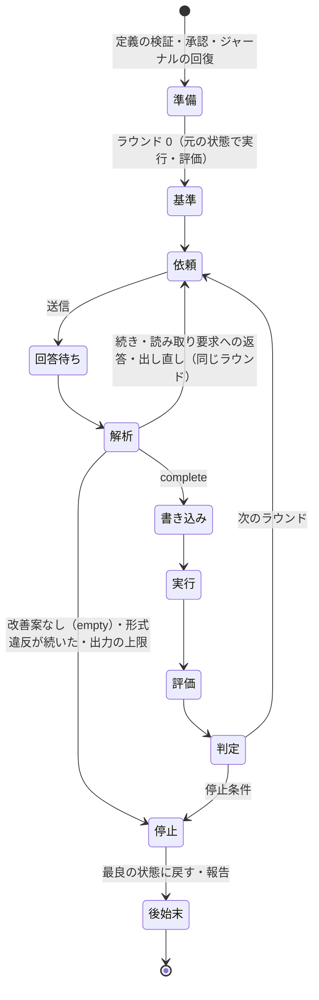

# ループ仕様（UC3）

> **状態: 下書き**（plan 5.6 の 2）。実物で確かめないと決められない項目には「PoC-7」と書き、14 章にまとめた。PoC-7 の結果を受けて確定する。

## 1. 範囲と前提

- UC3「ファイル出力と実行結果フィードバックのループ」の動きを定める。ループ定義、ラウンドの状態遷移、プロンプトの組み立て、回答の扱い、実行器、評価、記録、最良の状態への戻し、再開、利用量の予算
- ファイルの書式・解析・書き込みの手順は spec-file-protocol、画面操作は spec-browser-driver、規則の文面は spec-agent、マスキングと脅威モデルは spec-security（未作成）に従う。本書はそれらを**どの順に、どの条件で使うか**を定める
- UC4（コーディングループ）は、UC3 のループ定義で書ける（付録 A）
- PoC で分かった制約のうち、ループの設計に効くもの

| 制約 | 値（PoC） | 本書での扱い |
|---|---|---|
| 1 回の送信の上限 | 64,000 文字まで送れた（個人版・組織版） | プロンプトの予算 `max_input_chars`（既定 60,000） |
| 1 回の回答の出力の上限 | 約 8,000 文字（個人版）。組織版は 8,600〜27,000 文字の間 | 1 提案の大きさの上限（既定 7,000 文字）。超える場合は 6.4 |
| 上限を超えたときの AI | 個人版は途中を `...` にして書き切る。組織版は断る | どちらも「出力の上限を超えた」と判定し、繰り返さない（6.4） |
| 1 日の利用の上限 | 個人版で、数十回の送信で上限に達した | 送信の予算（11 章） |
| 人が送信する方式 | 個人版では自動の送信が拒否される | 対話の実行だけで使える（12 章） |
| U+00A0 | 送信の時点で普通の空白に変わる | 代わりの記号 `⟦U+00A0⟧` にして送り、戻す（spec-file-protocol 9.6） |

## 2. 用語

| 用語 | 意味 |
|---|---|
| ループ | 1 つのループ定義に従って、提案・書き込み・実行・評価を繰り返す一連の処理。実行ごとに run ID を振る |
| ラウンド | 「AI に提案を依頼し、書き込み、実行し、評価する」1 回分。0 番目は基準（AI に依頼しない、元の状態の実行） |
| ターン | 送信 1 回と回答 1 回（spec-file-protocol 3 章）。1 ラウンドは 1 ターン以上（続きの依頼・読み取り要求・出し直しでターンが増える） |
| 提案 | 1 ラウンドの AI の変更の全体（spec-file-protocol 3 章） |
| 実行器 | ループ定義のコマンドを起動し、結果を集める部品 |
| 指標 | 実行結果から取り出す数値（実行時間、エラーの数など）。最適化の向きを持つ |
| 最良の状態 | 成功条件を満たしたラウンドのうち、指標が最も良いラウンドの直後のワークスペースの状態 |
| run ディレクトリ | ループ 1 回分の記録の置き場（9 章） |

## 3. ループ定義（YAML）

### 3.1 例（設定ファイルの最適化）

```yaml
llmc_loop: 1                      # ループ定義の形式の版
name: tune-app-config
backend: copilot-m365             # サイト別プロファイルの名前（spec-browser-driver 3 章）。省略時は設定の既定

task:
  goal: |
    架空のサービスの設定 config/app.yaml を調整し、ベンチマークのスループットを上げる。
  constraints:
    - workers は CPU の数（8）を超えない
    - コメントを消さない

workspace: .                      # 書き込みと読み取りの基準。ループ定義のファイルの場所からの相対パス

context:
  files: [config/app.yaml, bench/README.md]   # 毎ラウンド送る文脈（全文）
  resend_before_edit: true        # spec-file-protocol 5.1
  same_chat_unchanged: omit       # 同じチャットでは、変わっていないファイルの中身を省く（FR-UC3-11）

write:
  allow: [config/app.yaml]        # 書き込みを許可するパス（パターン。spec-file-protocol 8.3）
  protect: [bench/**]             # 変更禁止（読み書きとも、ワークスペースの走査でも確かめる）
  delete: false                   # 削除を許すか
read:
  allow: [bench/**, docs/**]      # AI の読み取り要求に自動で応える範囲（FR-UC3-13）
  max_per_round: 5

run:
  commands:
    - argv: [python, bench/run.py, --config, config/app.yaml]
      timeout_s: 300
      env: {BENCH_SEED: "1"}      # ここに書いたものだけを足す（7.3）
  reads_config: [config/app.yaml] # 実行コマンドが読む設定（spec-file-protocol 9.1 の文字コードの判定に使う）

evaluate:
  success:
    exit_code: 0
    stdout_regex: "^RESULT: ok$"
  metric:
    name: throughput
    extract: {regex: "throughput=([0-9.]+)"}
    direction: maximize
    repeat: 3                     # 同じ状態で 3 回実行し、中央値を使う
    min_delta: 0.02               # 2% 以上良くなったときだけ「改善」とみなす
  same_failure: {by: [exit_code, error_signature]}   # 8.4

stop:
  max_rounds: 10
  no_improve_rounds: 3
  same_failure_rounds: 3
  protocol_error_rounds: 2
  max_sends: 40                   # 送信の予算（11 章）
  max_minutes: 120

feedback:
  log: {head_lines: 40, tail_lines: 80, max_chars: 6000}
  history: summary                # 試行の履歴の要約を毎回付ける（FR-UC3-06）

chat:
  mode: same                      # same / new_each_round / new_every: 5
  agent: null                     # 専用エージェントの名前（spec-agent）

masking: default                  # マスキング規則の名前（spec-security）

on_finish:
  restore: best                   # best / last / initial / none（10 章）
```

### 3.2 項目の規則

| 項目 | 規則 |
|---|---|
| `llmc_loop` | 必須。知らない版なら読み込まない |
| `workspace` | 実パスに解決し、ジャンクション・シンボリックリンクを経由しないこと（spec-file-protocol 8.4）。ワークスペースの外への書き込み・読み取りは、許可リストに書いても拒否する |
| `write.allow` | 空なら起動しない（何も書けないループは意味が無い） |
| `write.protect` | `write.allow` と重なる場合は protect を優先し、検証で警告する。常時禁止のもの（spec-file-protocol 8.3）は書かなくても禁止 |
| `run.commands` | **ループ定義に書いたものだけを実行する。AI にコマンドを決めさせない**（FR-UC3-04）。`argv` は文字列の配列。シェルを通す場合は 7.2 |
| `evaluate.metric.extract` | `regex`（stdout の最後に一致したもの）、`json`（stdout か指定ファイルの JSON のパス）、`file_regex`（ファイルの中の正規表現）のどれか |
| `stop` | どれかの条件に当たれば止める（8.5）。`max_rounds` は必須 |
| `chat.mode` | `same`: 1 つの会話を続ける。`new_each_round`: 毎回新しい会話（履歴の要約だけを引き継ぐ）。`new_every: N`: N ラウンドごとに新しい会話 |

- `llmc loop validate <定義>` と `--dry-run`（FR-UC3-15）で、パスの解決、パターンの重なり、コマンドの存在、正規表現の文法、1 ラウンド目のプロンプトの大きさを確かめる。送信はしない

### 3.3 実行の承認

AI が書いたファイルを、ループ定義のコマンドが読み込んで実行する。そのため、**ループ定義を初めて使うとき、または内容が変わったとき**は、実行の前に承認を求める。

- 承認の対象は、ループ定義のうち「何を実行し、何を書けるか」に関わる部分（`workspace`・`write`・`run`・`read`）の正規化したハッシュ。`task` の文面だけの変更では承認し直さない
- 対話の実行: 1 ラウンド目の実行の前に、コマンドと書き込み先の一覧を示して確認する（`y` で承認を記録）
- 非対話の実行（`--non-interactive`、スケジューラなど）: 承認の記録が一致するか、`--approve-exec` があるときだけ実行する。どちらも無ければ、送信する前に専用の終了コード（`EXIT_NEEDS_APPROVAL`。spec-shell-integration）で止める
- 承認は `llmc loop approve <定義>` でも記録できる。記録は `%LOCALAPPDATA%\llmc\approvals\` に置き、本人だけが読み書きできる権限にする

## 4. 状態遷移



- 各状態の始まりと終わりを run ディレクトリの `state.json` に書く（再開に使う。10.3）
- 利用者の中断（Ctrl+C）は、どの状態でも受け付ける。回答待ちなら画面の停止ボタンを押し（人が送信する方式では待ちをやめるだけ）、書き込み中なら書き込みを終えるか戻すまで待ち、実行中ならプロセスツリーを終了する。その後「後始末」へ進む

### 4.1 ラウンド 0（基準）

- AI に依頼する前に、元の状態で実行と評価を 1 回行う（`repeat` があればその回数）。結果を「基準」として記録し、1 ラウンド目のプロンプトに含める
- 基準の実行が成功条件を満たさない場合も続ける（「失敗を直す」ループのため）。基準の実行そのものが起動できない（コマンドが無い、タイムアウト）場合は、送信せずに止める
- `--skip-baseline` で省ける（前回の run の基準を使う場合）

## 5. プロンプトの組み立て

### 5.1 構成

1 ラウンドの最初のターンのプロンプトは、次の順に並べる。

| 順 | 部分 | 内容 |
|---|---|---|
| 1 | 見出し | プロトコルの版、規則の版、ターン ID（spec-file-protocol 5 章） |
| 2 | 規則 | 長い版か短い版（spec-agent 3.1） |
| 3 | 依頼 | `task.goal`・`task.constraints`。ラウンドの番号と残りの回数 |
| 4 | 書き込みを許可するパス・変更禁止のパス・読み取りできるパス | ループ定義から |
| 5 | 前のラウンドの結果 | 終了コード、成功条件の判定、指標、ログ（5.3）、ワークスペースの変化（8.6） |
| 6 | 試行の履歴の要約 | 5.4 |
| 7 | 現在のファイル | 文脈ファイル（`LLMC-CTX`）。5.2 |
| 8 | 末尾 | ターン ID をもう一度（出力の直前） |

- 文面の空行は、送る前に空行の代わりの行にする（spec-file-protocol 9.6）。U+00A0 は代わりの記号にする
- マスキングは、文脈ファイル・ログ・履歴の**すべて**に、組み立ての最後にかける（FR-UC3-19）。マスクの記号の対応表はラウンドをまたいで同じものを使う（AI が前のラウンドの記号を書き返せるように）

### 5.2 予算

- 全体を `max_input_chars`（サイト別プロファイル。個人版・組織版とも既定 60,000）に収める。超える場合は、次の順に削る

| 順 | 削り方 |
|---|---|
| 1 | 同じチャットで、前回から変わっていない文脈ファイルの中身を省く（`state=unchanged`。spec-file-protocol 5 章） |
| 2 | ログを短くする（先頭と末尾の行数を半分ずつ） |
| 3 | 履歴の要約を直近の N ラウンドに絞る |
| 4 | 書き込みを許可していない文脈ファイルを、先頭だけ（`range=head=50`）にする |
| 5 | それでも収まらなければ、送信せずにエラー（`E_PROMPT_TOO_LARGE`）。どの部分が大きいかを示す |

- 書き込みを許可したファイルは、全文を送る（一部だけ送ったファイルは書き換えられない。spec-file-protocol 5 章）
- **出力の側の上限も確かめる**: 書き込みを許可したファイルのうち、AI が書き返しそうなものの合計の大きさが、1 提案の上限（既定 7,000 文字）を超える場合は、プロンプトに「1 回の回答で書き換えるファイルは N 文字以内にする」旨を入れる。1 つのファイルだけで上限を超える場合の扱いは 6.4

### 5.3 実行結果の戻し方

- 終了コード、成功条件のそれぞれの合否、指標の値（`repeat` なら全回の値と中央値）、所要時間
- stdout と stderr は、別々に、先頭 `head_lines` 行と末尾 `tail_lines` 行を送る。間を省いた場合は「（N 行を省略）」と書く。合計を `max_chars` に収める
- 文字コード: 実行器で復号したもの（7.4）。復号できなかったバイトは `\xNN` で示す
- 長い 1 行（2,000 文字超）は途中を省く
- ログの中の `LLMC-` で始まる行は、先頭に `> ` を付けて送る（AI が回答の指示行と取り違えない、また解析器が自分のメッセージを取り違えないため）

### 5.4 試行の履歴の要約

- 1 ラウンドを 1〜3 行にまとめる: ラウンドの番号、変更したファイル、AI の変更の説明（回答の説明文の最初の 1 行、80 文字まで）、成功の合否、指標、失敗の種類（8.4 の署名の先頭）
- 最良のラウンドには印を付ける。「そのラウンドの状態に戻してから、次の提案をしているわけではない」ことも明記する（今のファイルは文脈として送ったものである）
- `chat.mode: same` でも毎回付ける（会話が長くなると AI が前の結果を取り違えるため）。長さは 1,500 文字まで（古いものから省く）

### 5.5 同じチャットを続けるか

| 方式 | 長所 | 短所 |
|---|---|---|
| `same` | 文脈ファイルの中身を省ける。AI が前の試行を覚えている | 会話が長くなると書式が崩れやすい（PoC-7 で確かめる）。回答の特定（仮想スクロール）の負担 |
| `new_each_round` | 毎回きれいな状態。書式が崩れにくい | 毎回、全文と長い版の規則を送る |
| `new_every: N` | 中間 | — |

- 既定は `same`。形式違反が続いた場合（8.5）は、止める前に 1 回だけ新しい会話でやり直す
- 既定と N の値は PoC-7（10 ラウンドの模擬）の結果で決める。個人版の 10 ラウンドでは、`same`＋短い版の規則で形式違反 0（組織版は未確認）

## 6. 回答の扱い

### 6.1 分類ごとの動作

解析の分類（spec-file-protocol 6.4）ごとに、次のように扱う。

| 分類 | 動作 | ラウンドのターン数 |
|---|---|---|
| `complete` | 書き込みへ進む | — |
| `truncated` | 続きを依頼する（spec-file-protocol 6.7）。未完成の項目の文脈ファイルは全文を送り直す（PoC-7）。上限は `continue_max`（既定 2） | +1 |
| `invalid` | エラーの内容を添えて出し直しを依頼する。上限は `retry_max`（既定 1）。超えたら、そのラウンドを「形式違反」とする | +1 |
| `empty` | 「改善案なし」。停止の理由として記録し、止める（`stop.on_empty: true`、既定） | — |
| `no_protocol` | 断り・質問・雑談として扱う。6.3 | +0〜1 |
| 読み取り要求だけ | 許可された範囲を読み、`LLMC-CTX` で返す（spec-file-protocol 7 章）。同じラウンドの次のターンになる。上限は `read.max_per_round` | +1 |

- 1 ラウンドのターン数の上限は `max_turns_per_round`（既定 5）。超えたらそのラウンドを形式違反にする
- 形式違反のラウンドは、書き込みも実行もしない。履歴の要約には「形式違反（コード）」と残す

### 6.2 再依頼の文面

- エラーコードごとの文面は spec-file-protocol 6.8 の表の「再依頼の文面」を使う
- 再依頼でも、規則は長い版にする（spec-agent 3.1）
- 同じエラーが 2 回続いた場合は、規則の該当する部分を抜き出して、例を付けて示す

### 6.3 書式の無い回答（`no_protocol`）

- 回答の文章から手がかりを調べる（PoC-6 の `hint`: 断り・上限・分割・質問・ファイルの作成）
  - 上限・断り: 6.4 の「出力の上限」として扱う
  - 質問（AI が確認を求めた）: 対話の実行なら、利用者に回答を示して返事を入力させ、その返事を次のターンとして送る。非対話の実行なら「質問には答えられないので、前提を置いて提案してください」と 1 回だけ返す
  - ツールでファイルを作った（ダウンロードのリンク）: `E_TOOL_ARTIFACT`。テキストで出すよう依頼する（spec-agent 5.1）
  - どれでもない: 書式を守るよう 1 回だけ依頼し、それでも無ければ形式違反
- 手がかりの判定は、誤りがあっても「繰り返しの回数」が変わるだけで、誤った書き込みにはつながらない

### 6.4 出力の上限を超える提案

- 次のどれかに当たれば「出力の上限を超えた」と判定する
  - `E_ELIDED`（`...` だけの行）があり、そのファイルの元の大きさか依頼の大きさが 1 提案の上限に近い（80% 以上）
  - `no_protocol` か計画だけの `truncated` で、手がかりに「上限」「断り」がある
  - 続きの依頼でも、同じファイルが同じ位置で切れた
- 判定したら、同じ依頼を繰り返さない。当面は、そのラウンドを `E_TOO_LARGE` として止め、利用者に「このファイルは 1 回の回答で書き換えられる大きさ（約 N 文字）を超えている」と知らせる
- v1 では、分割の出力・範囲の置き換えは使わない（spec-file-protocol 11.1。利用者の判断）。ループ定義の検証で、`write.allow` に 1 ファイルの中身の上限（既定 7,000 文字）を超えるファイルがあれば警告し、プロンプトでは「読むだけ」と示す

## 7. 実行器

### 7.1 起動

- ループ定義の `run.commands` を順に起動する。前のコマンドが失敗したら（終了コードが 0 でない）、後のコマンドは起動せず、そのラウンドの実行を失敗とする（`continue_on_error: true` で続けられる）
- **シェルを通さず、`argv` をそのまま `CreateProcess` に渡す**のが既定（引数の分割やリダイレクトの解釈が入らない）
- 作業ディレクトリは `cwd`（ワークスペースからの相対パス。既定はワークスペース）。ワークスペースの外は拒否
- 標準入力は空（`NUL`）。対話を求めるコマンドは、入力待ちのまま止まらず、タイムアウトで終わる
- コンソールのウィンドウは作らない（`CREATE_NO_WINDOW`）

### 7.2 シェルを通す場合

- `shell: powershell` か `shell: cmd` を明示したときだけ、`powershell.exe -NoProfile -NonInteractive -ExecutionPolicy Bypass -Command <文字列>` / `cmd.exe /d /s /c <文字列>` で起動する
- PowerShell 5.1 では、起動の前に出力の文字コードを UTF-8 にする前置きを足す（`[Console]::OutputEncoding` と `$OutputEncoding`。PoC-0 の結果。spec-shell-integration）
- 文字列の中に AI が書いたファイルの名前などを埋め込む機能は作らない（ループ定義の文字列だけを使う）

### 7.3 環境変数

- 親プロセスの環境を引き継いだうえで、`env` の値を足す。`env_remove` で消せる
- llmc 自身の内部の環境変数（デーモンの接続先など）は子プロセスに渡さない
- `PYTHONIOENCODING`・`PYTHONUTF8` を `run.python_utf8: true`（既定）で `utf-8`・`1` にする（Python のコマンドの出力を UTF-8 にそろえるため）

### 7.4 終了と出力の収集

- 各コマンドをジョブオブジェクトに入れ、`JOB_OBJECT_LIMIT_KILL_ON_JOB_CLOSE` を付ける（PoC-4 で、プロセスツリーごと終了できることを確認）。タイムアウト・中断のときはジョブを終了する
- 孫プロセスがジョブから抜ける（`CREATE_BREAKAWAY_FROM_JOB`）ことを防ぐため、ジョブに `JOB_OBJECT_LIMIT_BREAKAWAY_OK` を付けない
- stdout・stderr はパイプで受け、それぞれ `max_capture_bytes`（既定 8 MB）まで run ディレクトリに保存する。超えた分は捨て、捨てたことを記録する
- 復号: `encoding: auto`（既定）なら、UTF-8 として正しければ UTF-8、そうでなければ CP932 とみなす。`encoding: utf-8` などで固定できる
- 実行時間は、起動から終了までの壁時計の時間を記録する（指標に使える）

### 7.5 実行の安全（spec-security に詳しく書く）

- llmc が守れるのは、llmc 自身が書くファイルまで。実行された AI のコードの動作は守れない（NFR-16）。ループ定義の検証で、`write.allow` に実行されるスクリプトが含まれる場合は「AI が書いたコードを実行するループ」であることを示す
- 実行の前後のワークスペースの走査（8.6）で、変更禁止のファイルの変化を検出する
- 例 2（付録 B）のように、データを変える恐れがある場合は、ループ定義のコマンドの側で防ぐ（読み取り専用の接続、検査用のコマンド）。llmc の内蔵の簡易な検査（`write.content_deny`、書き込む中身の正規表現による拒否）は補助にとどめる

## 8. 評価と判定

### 8.1 成功条件

- `exit_code`（数値か配列）、`stdout_regex`・`stderr_regex`（一致すれば成功。`!` を付けると一致したら失敗）、`files_exist`、`metric_threshold`（例: `"<= 1.5"`）を組み合わせられる。すべて満たせば成功
- `repeat` がある場合、全回が成功したときだけ成功

### 8.2 指標

- `repeat` 回の値の中央値を、そのラウンドの指標とする。ばらつき（最大と最小の差）も記録する
- 指標が取り出せなかった場合は、そのラウンドを失敗とする（成功条件を満たしていても）
- `min_delta`（割合か絶対値。`0.02` は 2%、`"0.5s"` は絶対値）以上良くなったときだけ「改善」とする

### 8.3 最良の状態

- 成功したラウンドのうち、指標が最も良いもの。指標が無いループでは、最初に成功したラウンド
- 同じ値なら、変更の少ない方（書き換えた行数の合計が少ない方）、さらに同じなら早い方

### 8.4 失敗の同一性（FR-UC3-12）

- `same_failure.by` で、次の組み合わせを選ぶ
  - `exit_code`
  - `error_signature`: stderr（無ければ stdout）の末尾から、最初に `error`・`exception`・`エラー` などを含む行を探し、数字・パス・16 進の値・時刻を `#` に置き換えた文字列
  - `regex`: 利用者が指定した正規表現の最初のグループ
- 署名が同じ失敗が `same_failure_rounds` 回続いたら止める

### 8.5 停止条件

| 条件 | 既定 | 停止の理由（記録と終了コードに使う） |
|---|---|---|
| 成功（指標が無い、または `stop.on_success: true`） | 指標が無いループでは成功で止める | `success` |
| 最大ラウンド数 | 必須 | `max_rounds` |
| 改善が止まった | 3 ラウンド | `no_improve` |
| 同じ失敗が続いた | 3 ラウンド | `same_failure` |
| 形式違反が続いた | 2 ラウンド（新しい会話で 1 回やり直した後） | `protocol_error` |
| 改善案なし（`empty`） | 止める | `no_proposal` |
| 出力の上限 | 止める | `too_large` |
| 送信の予算・時間の上限 | 11 章 | `budget` |
| 利用上限（`RateLimited`）で、待っても回復しない | 待つ上限 30 分 | `rate_limited` |
| ログイン切れ・画面の変更 | 即座に止める | `login_required`・`selector_missing` |
| 利用者の中断 | — | `interrupted` |

- 終了コードとの対応は spec-shell-integration で定める

### 8.6 ワークスペースの変化の検出（FR-UC3-16）

- 実行の直前と直後に、ワークスペースを走査する（パス、大きさ、更新日時。1 MB 以下のファイルはハッシュも）。`scan.exclude`（既定: `.git/`、`__pycache__/`、`node_modules/` など）は除く
- 直前と直後の差から、llmc が書いたものを除いたものを「実行による変化」として記録し、次のプロンプトに一覧で含める（中身は含めない）
- 変更禁止のパスが変わっていれば、そのラウンドを失敗とし（`E_PROTECTED_CHANGED`）、利用者に知らせる。戻せる範囲（走査でハッシュを取ったファイル）は戻す。保証の範囲は spec-security で定める

## 9. 記録（run ディレクトリ）

`%LOCALAPPDATA%\llmc\runs\<run ID>\`。作業リポジトリの中には置かない。本人だけが読み書きできる権限にする（NFR-07）。

```text
<run ID>\
  loop.yaml               ループ定義の写し（実行したときのもの）
  state.json              状態（4 章）、現在のラウンド、会話の参照、承認のハッシュ
  summary.md              ラウンドごとの結果の表、最良のラウンド、停止の理由
  rounds\
    000\                  基準
      exec\               コマンドごとの stdout.bin・stderr.bin・result.json（終了コード、時間）
      metrics.json
      scan.json           実行の前後の走査の差
    001\
      turns\01\           送った本文（マスキング後。送ったとおり）、解析の結果（parse.json）
      turns\02\           続き・出し直し・読み取りの返答
      journal.json        書き込みのジャーナル（spec-file-protocol 10.3）
      snapshot\           書き込む前の元のバイト列（書き換え・削除したファイル）
      written\            書き込んだ後のバイト列
      exec\ metrics.json scan.json
  masks.json              マスクの記号と元の値の対応（暗号化して保存する。spec-security）
```

- 回答のコピーの HTML の原文は、既定では残さない（解析の結果だけ）。`--keep-raw` のときだけ `turns\NN\raw.html` に残す
- 保存の期間は既定 30 日。`llmc runs prune` で消す。消す前に、最良の状態を戻すかどうかを確かめる

## 10. 最良の状態への戻しと再開

### 10.1 終わりの戻し（FR-UC3-08）

| `on_finish.restore` | 動作 |
|---|---|
| `best` | 最良のラウンドの直後の状態（`written\`）に、llmc が書いたファイルを戻す。最良が無ければ `initial` と同じ |
| `last` | 何もしない（最後のラウンドの状態のまま） |
| `initial` | すべてのラウンドの書き込みを取り消し、ループの前の状態（ラウンド 1 の `snapshot\`）に戻す |
| `none` | 何もしない |

- 戻すのは**llmc が書いたファイルだけ**。実行による変化（8.6）は戻さない（一覧を示す）
- 戻す前に、そのファイルが llmc の最後の書き込みの後に変わっていないか（ハッシュ）を確かめる。変わっていれば戻さず、利用者に知らせる（利用者がループの間に手で直した場合）
- git の操作（commit、reset、stash）は行わない（FR-UC3-09）

### 10.2 後からの戻し

- `llmc loop restore <run ID> --round N`（N の直後の状態）、`--initial`
- `llmc undo` は、直前の書き込み（ラウンド 1 回分）を戻す（spec-file-protocol 10.3）

### 10.3 再開（FR-UC3-14）

- `llmc loop resume <run ID>`。`state.json` から、最後に**評価まで終わった**ラウンドの次から始める
- 途中のラウンド（書き込みや実行の途中で止まったもの）は、ジャーナルから書き込みを戻してから、そのラウンドをやり直す
- 会話: `chat.mode: same` なら、記録した会話の URL を開いて続ける（spec-browser-driver 8 章。**PoC-7** で、URL から開いた会話で続けられるかを確かめる）。開けなければ新しい会話にし、履歴の要約と全文を送る
- ループ定義が変わっていれば再開しない（承認のハッシュが違う）。`--force` で、変わった定義で続ける（承認し直す）

## 11. 利用量の予算

- 送信の数は、ターンの数と同じ。1 ラウンドは、ふつう 1 ターン、続き・出し直し・読み取りで最大 `max_turns_per_round`
- `stop.max_sends`（既定 `max_rounds × 3`）で、ループ全体の送信の数を制限する。上限に近づいたら（残り 3）、残りのラウンドを 1 ターンで終えるよう、読み取り要求を受け付けない
- サイトの利用上限（NFR-14、個人版の 1 日の上限）は、デーモンが数える送信の数と、画面の上限の表示（`RateLimited`）で扱う。上限の表示の文言は未記録（PoC-5 と、次に出たときに記録する）
- `--dry-run` は送信しない。1 ラウンド目のプロンプトと予算の内訳（文脈・ログ・履歴の文字数）を示す

## 12. 人が送信する方式でのループ

- 対話の実行でだけ使える（spec-browser-driver 13 章）。各ターンで、利用者が貼り付け・送信・コピーをする
- 会話の指定は「新しい / 同じ」だけ。`chat.mode: same` では、利用者に「同じチャットに続けて送る」よう案内する。利用者が別のチャットに送った場合は検知できないので、案内を目立たせる
- 実行と評価は自動で進む。利用者の操作は、送信とコピーだけ
- 1 ラウンドの手間を減らすため、続きの依頼・出し直しの文面は短くする

## 13. 例

例 1 は 3.1。例 2 と UC4 の例は付録に置く。

## 14. PoC-7 で確かめること

| 項目 | 確かめること | 決めること |
|---|---|---|
| 分割の出力・範囲の置き換え | **済（個人版）**: 両方とも完全に一致。v1 では使わない（拒否）と決定 | 6.4、spec-file-protocol 11.1 |
| 出力の上限の正確な値 | 個人版・組織版で 400・600 行など | 1 提案の上限の既定値 |
| 10 ラウンドの模擬 | **個人版は済**: 10 ラウンドとも 1 ターンで `complete`、エラー・警告 0。組織版は未確認 | `chat.mode` の既定、長い版の規則を送り直す間隔（spec-agent 3.1） |
| 読み取り要求 | `LLMC-READ` の往復が、書式どおりに回るか。個人版の 10 ラウンドでは、AI は一度も使わなかった（頼めば使うかを `--read-at` で確かめる） | 6.1 |
| 続きの依頼 | 途中切れ（出力の上限より小さい理由のもの）からの続きが通るか | spec-file-protocol 6.7 |
| 会話の URL | 新しいページで会話の URL を開いて続けられるか。10 ターン以上での回答の特定（仮想スクロール） | 10.3、spec-browser-driver 5・8 |
| 長い回答と完了の信号 | 100 秒を超える回答を最小化したまま取り、停止ボタンとコピーボタンの出方を記録する | spec-browser-driver 6 |
| 履歴の要約の効き目 | 要約があると、同じ失敗を繰り返しにくいか（試せる範囲で） | 5.4 |

## 15. 未決事項

- 分割の出力を採る場合のプロトコルの形（spec-file-protocol 11.1）
- マスクの対応表の暗号化の方式（DPAPI など。spec-security）
- `write.content_deny` を内蔵するか、検査用のコマンドに任せるか（spec-security）
- 終了コードの体系（spec-shell-integration）
- 複数のループを同時に動かした場合（デーモンの直列のキューで順番待ちになる。spec-daemon）

---

## 付録 A. UC4（コーディングループ）をループ定義で書く

```yaml
llmc_loop: 1
name: fix-failing-tests
task:
  goal: tests/ のテストがすべて通るように src/ を直す。テストは変えない。
workspace: .
context:
  files: [src/calc.py, tests/test_calc.py]
write:
  allow: [src/**]
  protect: [tests/**, pyproject.toml]
read:
  allow: [src/**, tests/**]
run:
  commands:
    - argv: [python, -m, pytest, -q, -x]
      timeout_s: 600
evaluate:
  success: {exit_code: 0}
  same_failure: {by: [error_signature]}
stop:
  max_rounds: 8
  same_failure_rounds: 3
chat: {mode: same}
on_finish: {restore: best}
```

- テストを変えさせない（`protect`）ことで、テストを書き換えて通す提案を防ぐ。テストのファイルが実行中に変わった場合も 8.6 で検出する

## 付録 B. 例 2: SQL クエリのチューニング（実行時間を最小化）

```yaml
llmc_loop: 1
name: tune-report-query
task:
  goal: |
    sql/report.sql の集計クエリを速くする。結果の行と値は変えない。
  constraints:
    - SELECT 文だけを書く。テーブルの作成・更新・削除はしない
    - ヒント句は使ってよい
workspace: .
context:
  files: [sql/report.sql, sql/schema.sql, sql/explain_last.txt]
write:
  allow: [sql/report.sql]
  protect: [sql/schema.sql, tools/**]
  content_deny:                  # 補助の検査（7.5）。本当の守りは読み取り専用の接続
    - "(?i)\\b(insert|update|delete|merge|drop|alter|truncate|create|grant)\\b"
run:
  commands:
    - argv: [python, tools/sqlguard.py, sql/report.sql]          # 利用者が用意する検査（SELECT 以外を拒否）
      timeout_s: 30
    - argv: [python, tools/bench_query.py, --dsn-env, REPORT_DSN, --sql, sql/report.sql,
             --explain-out, sql/explain_last.txt, --check-result, tools/expected_hash.txt]
      timeout_s: 600
      env: {REPORT_DSN_READONLY: "1"}
evaluate:
  success:
    exit_code: 0
    stdout_regex: "^RESULT_HASH_OK$"
  metric:
    name: elapsed_ms
    extract: {regex: "elapsed_ms=([0-9]+)"}
    direction: minimize
    repeat: 3
    min_delta: 0.05
stop:
  max_rounds: 10
  no_improve_rounds: 3
masking: with-db                 # 接続文字列・ホスト名・スキーマ名を置き換える規則（spec-security）
on_finish: {restore: best}
```

- 接続情報は環境変数（`REPORT_DSN`）で渡し、ループ定義にもプロンプトにも書かない。実行計画（`explain_last.txt`）とログには、ホスト名やスキーマ名が出得るので、`masking: with-db` で置き換えてから送る
- 結果が変わっていないことを、検査のコマンド（`expected_hash.txt` との比較）で成功条件にする。速くても結果が違えば失敗
- 接続は読み取り専用のユーザーにする（利用者の責任。ループ定義の検証では、`run` のコマンドの引数や環境に読み取り専用の印があるかは判断できないので、確認の画面で注意を示す）
